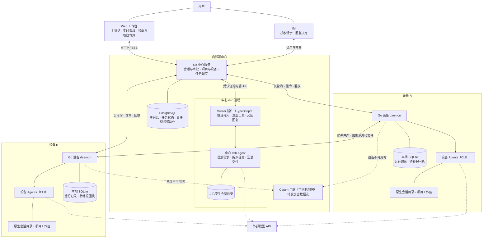
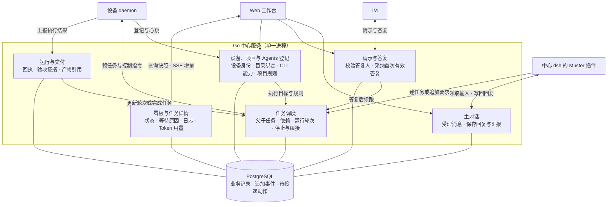
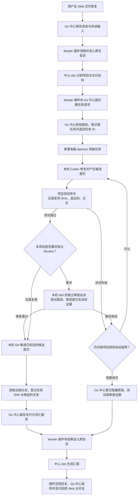

# Agent Muster v0.1 设计文档

首版设计稿，涵盖产品行为、组件职责、数据流、故障恢复和验收标准。第 7.2 节以「让家里电脑的 Codex 修 bug，办完告诉我」说明无人值守交付。第 10 节列出需要联调的假设。四个参考项目的功能、实现和逐项取舍另有源码调研。[四项目对照与专题索引](参考项目调研/README.md)

**首版技术路线（2026-11-19 确认）**　Go 中心服务管理任务并独占写入 PostgreSQL。中心 dsh 作为独立进程运行，通过 TypeScript 插件领取消息、调用派发工具和交回回复。Windows 设备使用 Go daemon 和本地 SQLite。Web 使用 React、TypeScript 和 Vite。官方 Docker Compose 默认随中心启动 PostgreSQL，也支持部署者提供已有 PostgreSQL 的连接信息。

## 1. 一个入口，一条对话

Agent Muster 为自建的多设备环境提供一个对话入口。你在 Web 上跟中心 dsh 说话，它可以直接回答，也可以把工作派给家里或公司的设备 Agents。设备 Agents 指已安装在设备上、能通过 CLI 接收提示词、给出最终回复并续接会话的执行工具。它们使用原有账户、权限和 skill，在绑定的素材目录、日志目录或代码仓库里工作。中心 dsh 和设备 Agents 都通过外部 API 调用模型。

| 你看到什么 | 它记录什么 | 什么时候更新 |
| --- | --- | --- |
| 一条长期主对话 | 你提出的需求、中心的回答、任务的请示和汇报 | 不同设备和项目共用这条时间线。任务完成或归档后，原对话仍可回看。 |
| 看板上的多张任务卡 | 每个目标、当前承办设备、进展、等待原因、结果与证据 | 任务独立推进。中心受理后，你随时可以交代下一件事，也可以向原任务追加要求。 |
| IM（即时通讯）里的请示 | 需要你决定的具体问题 | 与 Web 上同一条请示同步。任一端回答后，任务带着答案继续。 |

任务只有两种情况会主动进入主对话。**请示**要说清需要用户决定什么；**汇报**带回用户已经可以使用的结果，或说明任务为何无法完成。任务启动、心跳、子任务往来以及逐行命令输出都在看板或设备日志里查看。点击卡片可查细节，用户主动问进度时，中心也可以直接回答。

## 2. 从两台设备看一次完整交付

家里电脑登记了素材目录和默认 dsh，公司电脑登记了文档目录和默认 Codex。首次接入时确认这些绑定，日常用法如下。

1. **交代第一件事。** 你说「把上周的素材整理成索引，再写一份说明」。Go 中心保存消息后即可受理下一条。中心 dsh 通过插件建根任务，让家里 dsh 先整理索引。
2. **设备继续派活。** 家里 dsh 编好初稿，通过本机 `muster` 把写说明交给公司 Codex，两台设备直接交接索引小文件。公司端确认收件后开工。看板显示父子任务和投递状态，父任务等待期间释放执行名额。
3. **同时处理第二件事。** 你又说「顺便查一下家里昨晚的备份日志」。中心将它建为独立任务。设备和目录条件允许时即可开始；即使需要排队，用户也能继续使用主对话。
4. **改要求或回答问题。** 你补充「第一件事的索引改成 CSV」。这条输入归到素材任务，下一轮在原设备、原会话处理。如果说明依赖更新后的索引，设备交接新版本，再完成说明。确实需要你决定的事从 Web 或飞书请示一次。
5. **看结果。** 素材任务在索引和说明都交付后发一条最终汇报，附上两份产物的位置；日志任务独立汇报排查结论。公司设备途中离线时，看板会显示等待交付或最后确认的状态，主对话继续受理工作。

### 首版范围

| 范围 | v0.1 能力 |
| --- | --- |
| 入口 | Web 主对话、实时看板、任务详情和设备、项目、Agents 管理。IM 承担请示推送与回复，首版接入飞书。 |
| 调度 | 中心 dsh 和设备 Agents 均可拆派。任务支持并行、前后依赖、追加要求、暂停、停止和同机续接。 |
| 执行 | Windows daemon 通过 CLI 调用设备 Agents，首批支持 dsh 和 Codex。原生会话、配置和凭据由对应 CLI 和设备管理。 |
| 协作 | 设备之间交换消息、结果和小文件。中心保存任务关系、运行事件、已上报的诊断片段和汇报摘要。 |
| 运维 | Web 查看设备及 CLI 状态、控制任务、查询日志与可取得的 token。CLI 安装、升级、原生配置和登录由设备本地处理，远程管理列入后续版本。 |

## 3. 系统架构

### 系统总览

用户通过 Web 与中心 dsh 交谈，IM 只接收请示并回传答复。图中用两台设备表示同一中心下的多个执行端。每台设备主动连接中心领取任务。跨设备交接使用 WebRTC，设备优先选择可用的直连，异地网络无法直连时自动使用部署者配置的 TURN 服务。

Web 上可见的主对话存入 PostgreSQL，中心 dsh 继续推理时读取自己的原生会话。中心 dsh 重启期间，Go 服务仍可接收用户消息、设备回执和请示答复。在设备上，daemon 用 SQLite 记住哪些回执还要补报，设备 Agents 回到原设备的会话目录和项目工作区继续执行。

### Go 中心服务内部

下图中的会话、审批、资源登记、调度、交付和看板都在同一个 Go 服务内运行。插件和设备通过各自的接口调用它，只有 Go 服务读写中心业务库。官方部署的三个服务及其持久卷见第 10 节。

一次交付分两步完成。设备回执满足项目的验收规则后，Go 服务在同一事务中登记根任务完成和待汇报项。插件随后将结果送入中心 dsh 生成汇报，Go 服务将回复写回用户发起任务的那条对话。普通执行进度通过 SSE 更新看板，详见第 6.3 节和第 8.2 节。

| 组件 | 职责和数据归属 |
| --- | --- |
| Go 中心服务 | 对外提供 Web、IM 和设备接口，是中心业务库的唯一写入方。受理消息，校验项目授权，派发任务，接收运行与验收证据，维护看板。中心 dsh 重启期间仍可接收消息、设备回执和审批答复。 |
| 中心 dsh | 独立常驻，按需调用外部模型。持有长期主会话，判断直接回答、创建任务或追加要求，解读结果并生成汇报。其模型上下文使用 dsh 原生存储。 |
| Muster 中心插件 | 在中心 dsh 进程内加载，只给指定的中心会话注册查设备与项目、建任务、追加要求、查结果等工具。工具携带来源消息和调用标识访问 Go 服务。插件领取待送入 dsh 的用户消息和交付结果，回传处理回执与最终回复。 |
| Go 设备 daemon | 主动通过 HTTPS 长轮询领取任务和控制指令，分别上报心跳、启动与退出回执。用设备 SQLite 保存执行记录和待补报项，按本机配置启动、监控和停止 CLI。 |
| 设备 Agents（CLI） | 使用现有模型账户、配置和 skill 执行。会话文件留在各自原生目录，工作文件留在绑定目录或项目指定的输出位置。 |
| Web 与 IM | React + TypeScript 界面用 Vite 构建，由 Go 服务同源提供静态文件、HTTP API 和 SSE 看板事件流。IM 渠道推送请示并回传用户答复，两个入口共用任务及请示状态。 |

中心插件从 dsh Superagent 借鉴会话级工具注册、按请求标识投递输入的做法。设备端继续按提示词、最终回复和原生续接三个 CLI 能力接入。Muster 自行定义任务模型和设备协议，参考 Autoloop 的领活、回执重传和断线对账机制。[原型会话投递与工具注册](https://github.com/deepseek-ai/dsh-superagent-prototype/blob/8c32a9dc5d72c033816c6a8110b37f40cf94fba4/src/app/sessions.ts#L138-L214) · [Autoloop 源码调研](参考项目调研/02-agent-autoloop.md)

Go 中心服务与 Windows daemon 都要维护连接、处理回执并在重启后恢复。两端采用 Go，可共用任务与回执的数据结构，同时分别发布服务器程序和设备可执行文件。只有中心插件需要对接 dsh 的会话和工具接口，这部分随 dsh 宿主使用 TypeScript。

### 3.1 配置与路由

1. 用户在设备本地安装并登录 CLI，启动 daemon，用一次性配对凭据登记设备。daemon 回报设备名、在线状态、可用 CLI 及版本。
2. 用户告诉中心 dsh 要接哪个项目。中心根据已登记设备、目录和 CLI 给出绑定提案，用户确认后保存。也可从管理页编辑。一个项目可有多个设备绑定，每个绑定指定目录、默认 CLI 和配置档。
3. 用户新建任务时，中心根据项目别名、语义和明确指定的目标匹配项目。目标明确时沿用预设。默认设备离线时任务排队，中心可以继续处理其他请求。找不到唯一项目或目录且无法从上下文判断时，才问用户。
4. 首次派发时记录设备、目录、CLI 和项目规则版本。任务续接沿用该绑定。变更默认配置影响后续派发，已有任务仍可读取最初采用的规则。设备丢失或会话无法续接时，用户可以另建任务并明确提供原任务摘要。

### 3.2 权限边界

任务实际能力由 **设备用户、CLI 权限和所绑定的工作目录**共同决定。中心可以按已保存的项目规则派发任务。重复出现的权限不足由用户在对应设备和目录调整 CLI 配置，一次配置后日常任务沿用。单次业务判断仍可通过请示解决，例如选择处理哪批资料。

daemon 以已有 CLI 的设备用户运行，中心派发时引用已登记的配置档和目录 ID。用户输入作为提示词传给 CLI，启动命令和参数由设备配置解析。Web 管理和请示回复要求已登录的部署者身份，设备各自持有可撤销的接入凭据。中心保存 IM 渠道配置，设备 CLI 的模型和 Git 凭据归本机管理。各 CLI 根据现有配置调用外部模型 API。

## 4. 主对话与任务生命周期

### 4.1 受理、规划与多任务执行

Web 提交消息后，Go 中心将可见消息与待送中心 dsh 的记录一起提交到 PostgreSQL，再返回受理状态。插件按消息 ID 领取消费，将输入送入长期主会话。中心 dsh 可以直接回答，也可调用插件工具。建任务的工具收到持久化的任务 ID 就返回，设备执行在后台继续。耗时规划可使用独立后台会话。主 dsh 原生会话逐轮串行，用户在模型繁忙时仍可提交下一条消息。

插件重启后按原生会话引用和稳定消息 ID 核对待送输入。dsh 已接收而中心尚未收到确认时，先核对原会话的收件或历史记录。已产生的工具结果可按同一业务键取回；普通回复和最终汇报写回 Go 中心时也使用稳定消息键。Web 始终以 PostgreSQL 中已提交的消息为准。

中心为每个用户目标生成一个根任务。根任务可以直接执行，也可以聚合多个已绑定设备的子任务。依赖满足的任务并行运行，争用同一工作目录的写入轮次默认串行。Git 项目可为并行修改配置独立 worktree。父任务等待子任务时释放执行名额和当前轮的目录锁。恢复前，CLI 重新核对工作现场、最新要求和已交付结果。

用户在主对话中追加要求时，中心按当前上下文或任务编号定位任务，将新要求写入待处理输入。运行中的 CLI 在本轮结束后接收它，暂停或等待中的任务在具备续接条件时接收它。针对组织和交付结果的自动步骤，在开始前检查已有追加要求是否处理完毕。已经发生的外部操作在详情记录实际结果，后续要求作为同一任务的新运行处理。

### 4.2 状态与事件

主对话追加的要求和设备间交付的文件都使用可关联的输入 ID。设备确认收件后，中心可显示「已送达」。本轮结果说明已经处理哪些 ID 后，才把对应输入从待处理列表移出。若 CLI 已启动却在提交结果前中断，保留会话、输入和已产生的文件，恢复时带着这些信息核查现场。对于已经执行但缺少回执的操作，送达去重本身无法证明其业务结果。

| 任务状态 | 判定与后续动作 |
| --- | --- |
| 排队 | 等待规划、设备上线或执行名额。条件具备后分配运行 ID。 |
| 运行中 | daemon 已确认开始这一轮。启动、日志、会话 ID 和退出结果关联到该轮记录。 |
| 等待依赖 | 等子任务、消息或产物。所需输入已入库或经设备接收确认后进入续接队列。 |
| 待回复 | 有持久化的请示等待用户。当前 CLI 轮次已结束。 |
| 已暂停 | 用户主动暂停，或执行中断需要核对现场。面板显示原因与可续接状态。 |
| 已完成 | 已取得最终结果，项目设定的验收步骤已满足，必需的子任务已返回。 |
| 已失败 | 已有明确失败结果，且自动恢复或返修机会已用尽。保留运行证据，可手动重试。 |
| 已取消 | 用户撤销整项任务。排队任务直接撤销，运行中的任务收到设备终止回执后标记为已取消。重新交办时创建新任务。 |

任务状态和设备在线状态独立记录。离线设备上的运行显示最后一次确认状态及更新时间。「暂停」让当前轮结束后暂缓下一轮。「停止当前轮」用于处理卡住的运行，设备确认终止前显示「正在停止」。daemon 只处理该轮启动的 Windows 进程树，确认后释放名额并将任务置为已暂停。可保留的工作文件和会话供下次续接。

### 4.3 谁可以续接原生会话

每个由 Muster 管理的原生会话，同一时间只允许一个执行轮次写入。中心记录设备、CLI 配置档、工作目录、原生会话 ID 和当前运行 ID。设备 daemon 在启动或续接前核对本机执行记录并互斥启动。CLI 报告会话正被其他进程占用时，这次续接排队并显示占用原因。

设备心跳超时只改变连接状态。只要上一次执行的去向仍不清楚，中心保留它的占用记录。重连后，daemon 确认原进程仍在就继续监督；确认已退出就补报退出证据，核对未完成动作后才允许新轮次接手。旧运行的迟到回执只更新旧记录。会话损坏或版本不兼容时，用户可从任务详情选择带摘要另开任务，标记为「重新接手」并链接原任务。普通休眠则保留原会话，等待期间的这项任务无需调用模型。

## 5. 设备协作与交付协议

### 5.1 两层拆分

- 中心 dsh 可以把一项工作拆成多个独立任务，定义依赖关系并自动选择设备。
- 设备 Agents 可以使用 CLI 自带的子 Agent，也能在运行中用 `muster` 本机命令请求派发可在看板追踪的子任务。`muster` 由 daemon 提供，识别当前任务和运行身份，支持派发、发送、收取和查询状态。发起方可以继续处理自己的工作，也可以在轮末声明需要等待哪些结果。父任务与子任务通过 ID 关联，调度拒绝循环依赖。
- 同一 CLI 内的协作随原生 CLI 执行。跨设备的任务创建、状态和投递确认由中心记录。设备 Agents 通过各自的 daemon 交接内容，中心 dsh 无需逐条阅读或转述。需要父任务处理的报告或交接结果触发原会话续接。

### 5.2 控制与数据传输

1. 发送设备请求创建子任务时，中心校验父任务、目标设备和项目绑定，登记子任务与待交付记录，并返回目标及投递标识。
2. 发送设备将提示词正文、补充说明或小文件写入本地待发队列。Hub 交换 WebRTC 信令，双方通过 ICE 检查连接候选，优先使用直连候选，直连建立不了时选用已配置的 TURN 中继候选。接收端验证投递授权、大小和摘要，写入本地收件记录后应答。固定公钥试点还会校验对端信令签名。中心保存传输双方、状态和校验信息。
3. 接收设备向中心上报已接收。依赖正文或附件的任务在接收确认后才进入执行。重复投递复用同一个投递 ID，接收端返回已记录的确认，父任务和子任务只各触发一次对应的唤醒。
4. 连接失败时由发送端保留待发数据并退避重试。看板显示等待交付及最近错误。结果文件依同样流程回传，可以用摘要和共享链接交接大型文件。设备间消息和文件正文保存在设备。执行方向中心上报汇报摘要、运行事件以及用于诊断的日志片段，详见第 8 节。

部署者可以在同一台 VPS 上运行独立的 Coturn，也可以填写独立的 TURN 服务地址。设备无需手工配置 VPN。WebRTC 先收集并检查本地、STUN 反射和 TURN 中继候选，由 ICE 为每笔交接选择可用路径；直连不可达时使用 TURN。若 Hub 与 Coturn 同机，防火墙规则需允许 Coturn 的中继端口相互通信，保障同一实例上的两个分配可以传输。中继只转发设备之间的 DTLS 加密数据流，业务库保存信令、投递摘要和回执。经中继传输的字节计入中继服务器的带宽与流量。公网中继对获准设备发放短期凭据，限制分配寿命、并发、带宽和可达的目标地址。没有可用路径时设备继续保留待发队列。[Coturn](https://github.com/coturn/coturn) · [ICE 标准](https://www.rfc-editor.org/rfc/rfc8445) · [TURN 标准](https://www.rfc-editor.org/rfc/rfc8656) · [WebRTC 传输要求](https://www.rfc-editor.org/rfc/rfc8835)

Hub 的控制地址可以继续使用 HTTP。普通设备包信任经 Hub 交换的信令，其对端身份依赖控制网络保持可信。固定公钥的验收包只为指定投递使用 TURN，并校验双方信令签名，将设备双方、投递、握手尝试和 DTLS 指纹绑定在一起。设备私钥存放在本机。首次公钥声明只证明登记者持有设备令牌，通过 HTTP 登记时需要可信带外渠道核对双方指纹，以防控制链路上的流量被替换。HTTP 部署的网络信任边界还覆盖设备令牌和 TURN 短期凭据。部署者可以继续为可达的设备配置局域网或 VPN 地址。家里和公司设备使用相同的传输规则。

**双机试点。** 两台 Windows 的 IPv4 网络表现为端点依赖映射，路由器未提供可用的入站映射，直连时 ICE 检查没有得到有效往返。2026-11-22，两台 `0.2.7` 设备完成一次异网消息交接，双方选中 TURN 候选，DTLS 握手成功，Hub 记录签收，发送队列清除。Coturn 保留服务器总带宽上限，同时为两台设备各自的 UDP 与 TCP 分配留出容量。试点使用一个预先指定的投递，通用设备公钥管理属于后续交付。[Tailscale 连接排障](https://tailscale.com/docs/reference/device-connectivity) · [Coturn 分配逻辑](https://github.com/coturn/coturn/blob/4.6.1/src/server/ns_turn_server.c)

## 6. 一轮 CLI、请示与汇报

### 6.1 最小 CLI 接入

daemon 的 CLI 配置描述启动、续接、提示词输入和结果读取。首版提供 dsh 与 Codex 两个配置。结构化输出可提取原生会话 ID、最终回复和可选用量。最终回复需结合进程退出结果判断，失败轮次也可能产生说明文本。CLI 事件可以辅助显示状态，整个工具调用协议由原生 CLI 处理。

普通任务可以用最终文本直接交付。需要表达请示、等待依赖或确认追加指令时，再附带相应的结构化字段。遇到残缺回执，daemon 保存最终文本和原会话引用，有续接能力时仅请求补写回执。若仍无法确认结果，在详情显示需要核对的原因。对原生 CLI 没有公开的内部子任务，只展示能够观测到的 CLI 轮次；通过 Muster 派出的子任务有各自的状态和结果。

| 轮末结果 | 下一个动作 |
| --- | --- |
| 已交付结果 | 持久化最终摘要和产物引用，按项目规则启动下一阶段或结束任务。 |
| 等待子任务或产物 | 记录依赖并释放当前轮资源，接收确认或子任务结束后携带结果续接。 |
| 请求用户决定 | 记录问题、选项或文字输入、影响范围与关联任务，在 Web 显示并通过 IM 推送。 |
| 已知失败 | 保留退出原因和原生会话引用。可确定恢复且仍有预算时续跑，其他情况汇报失败或标记中断。 |

### 6.2 Web 与 IM 共用一次请示

设备 Agents 在轮末回复中提出请示，由 daemon 上报。中心写入请示记录后，在 Web 显示问题，并通过 IM 推送给与部署者绑定的账号。两端引用同一个请示 ID。首版通过飞书自建应用发送私聊卡片，用长连接接收按钮选择或文字答复。

用户在任一入口回答后，中心验证用户与请示的绑定。数据库在同一事务内保存第一个有效答复并记录续接请求。重复提交返回已有答复。设备离线时显示「已答复，等待设备」，续接成功处理该输入后才显示「已处理」。IM 通知发送或更新失败只重试该条通知，Web 仍可查看或回答。拒绝操作与文字答复同样作为原会话输入，执行该任务的 Agent 可选择其他做法或结束任务。

### 6.3 结果汇报

执行设备先保留原始交付，再向 Go 中心登记产物引用、验收证据和可供展示的结论。根任务达到交付条件时，Go 中心在同一事务中登记完成状态、完成事件和待汇报项。插件领取后将证据送入中心 dsh；回复经 Go 中心按「根任务 ID、本次交付 ID」只写入主对话一次。中心 dsh 忙碌、升级或摘要生成失败时，详情页可先展示已登记的结论与引用，待汇报项留待恢复。原件的可用性取决于所在设备或共享位置。对于部分失败，汇报注明已成功的子任务与阻塞环节。设备间的普通协调和逐条进度留在任务详情。最终汇报只进入 Web 主对话。

## 7. 项目工作流示例

### 7.1 普通目录的验收规则

第 2 节的素材任务以索引和说明为交付物。索引格式以最后确认的输入为准，说明应引用实际交付的索引版本。设备在交接记录中保存文件标识与摘要，索引有更新时，接收方重新核对受影响的说明。任务详情列出各交付物所在设备、路径和验收结论。

### 7.2 Git 项目的自动修复与推送

项目可预设远端及目标分支、测试命令或测试 skill、Review 方式与可选的审查 Agent。默认可用独立任务分支，也可为指定项目明确配置推送到其默认分支。中心 dsh 可读取项目已有的约定并据此建议配置，推送工作流按已确认的项目设置运行。

1. 在对应目录或项目指定的 worktree 中修复，保留用户已有的无关更改。生成候选提交，记录最终快照。
2. 设备在可核对的候选工作区执行项目配置的测试，记录测试命令、候选 SHA、退出码和日志引用，确认受测文件与候选匹配。需要独立 Review 时，另开审查会话，把基线、候选 SHA、差异和验收条件交给项目指定的审查 Agent。审查者可与修复者使用不同 CLI。任一验证发现可修问题，就把证据交回原修复会话。候选提交变化后重新验证，返修达到项目预算时汇报具体阻塞。
3. 达到推送条件后，由配置好的项目流程推送该候选提交，随后核验远端引用。响应丢失时先回读远端。远端指向候选时确认交付；远端已推进且包含候选时记录「已包含」和观察到的 SHA。远端暂不可读时保持待核对；出现分叉或受保护分支拒绝时，保留候选和失败证据，按项目授权决定能否自行返修。
4. 根任务汇报测试结果、Review 结论（如有）、提交 SHA 和实际远端分支。推送门槛约束 Muster 管理的工作流。CLI 是否可以通过自身工具执行 Git 操作取决于设备和远端已有权限。

以「家里 Codex 修复，按项目设置用 dsh 复审」为例，下面从上至下展示一次交付。各框中的设备命令均由该轮的 daemon 启动或监督。测试失败或审查提出可修的问题时，设备将证据交回原 Codex 会话；修出新提交后从测试重新开始。

用户授权项目自动交付后，测试、可选 Review、返修和推送都沿已保存的规则运行。能自动解决的错误留在看板；只有出现需要用户选择且会改变下一步的问题才发请示。例如允许推送的任务分支与这次明确要求的受保护分支不一致，中心可以请用户选择交付路径。返修预算用尽而没有可选决策时，直接汇报失败原因与已经保留的成果。

## 8. 持久化与接口设计

### 8.1 数据存放与设备离线后的可见性

| 数据 | 存放与传递 | 执行设备离线时，Web 能看到什么 |
| --- | --- | --- |
| Web 可见的主对话、请示与答复 | Go 中心写入 PostgreSQL。中心 dsh 的模型上下文和原生会话历史存于其宿主持久目录，插件用消息 ID 关联两侧记录。 | 已保存的对话和卡片可以查看，追加要求或答复先入队。 |
| 任务进展、汇报、用量和诊断片段 | 中心保存已收到的状态事件、结论、退出原因、可读用量和明确上报的日志片段。诊断片段可含任务相关文本。 | 展示最后确认时间和已有片段，待补报的用量保持未知。 |
| 设备 CLI 的完整会话、原始 stdout／stderr | 原生会话存 CLI 自己的目录，daemon 将执行日志按轮次保存在本机。用户从 Web 查看原始日志时，经已认证的设备连接按需读取。 | 可查日志归属、轮次和已有片段；读取其余原文需要设备上线。 |
| 设备执行账与待补报项 | 每台 Windows 设备使用独立的本地 SQLite，开启 WAL。daemon 持久化已领取的运行、进程和原生会话引用、输入收件记录、待发回执及文件交付元数据。结果先在本地提交，收到中心确认后标记已上报。 | 显示 Go 中心最后收到的事实。重连后通过 API 按 ID 补报并核对两侧记录。 |
| 产物与设备间消息 | 源文件、收件正文和投递队列在有关设备上；中心保存产物名、位置、摘要、依赖和确认状态。项目也可交付可访问的共享链接。 | 显示产物引用和已确认的接收方。原件可从仍在线的持有设备或可用共享位置取得。 |

### 8.2 PostgreSQL 业务记录、事件与待投递表

首版中心库只支持 PostgreSQL，由 Go 服务执行迁移和业务读写。浏览器、中心插件、IM 和设备通过服务接口操作。选择 PostgreSQL 的原因是设备回执、用户审批和后台派发可同时到达，中心可用条件更新、行锁和唯一约束在库内裁定同一任务的并发写入。设备的执行记录由本机 daemon 维护，需要断网也能落盘，用本地 SQLite 即可。任务看板直接查询当前状态表；追加事件用于查看历史和断线补读；待投递表（outbox）用于记录提交后仍需完成的动作。

| 记录 | 必需内容 |
| --- | --- |
| 设备、项目及绑定 | 设备 ID、在线时间、CLI 能力与版本。项目别名、设备绑定、目录、默认配置档和规则版本。 |
| 主对话消息 | 消息 ID、时间、顺序、关联根任务、消息类型和正文。 |
| 任务及依赖 | 父任务、目标、绑定快照、状态、必要前置任务和产物、待处理输入、结果摘要。 |
| 执行轮次 | 运行 ID、所属任务、原生会话 ID、开始与结束、心跳、退出信息、可选 token、日志引用。 |
| 请示及通知 | 请示 ID、问题与可选答案、答复人、答复内容、IM 渠道与原消息标识、续接请求。 |
| 设备间投递 | 投递 ID、两端设备、关联任务、大小或摘要、接收确认。正文、文件和待发记录保存在有关设备。 |
| 追加事件 | 回放游标、对象和运行 ID、事件类型、来源、时间及摘要。设备事件以「运行 ID、设备事件序号」去重。 |
| 待投递动作 | 业务键、动作类型、目标、负载引用、领取者、领取期限、下次重试时间及确认状态。设备指令、送入 dsh 的消息、待写的汇报和 IM 通知各有稳定业务键。 |

**一项决定，一次提交。** Web 和 IM 同时答复时，Go 服务仅允许将仍处于待回复的请示更新为已答复。赢得更新的事务同时写入答复、追加事件、设备续接待办和 IM 通知更新待办。后到的请求返回已经保存的答复。类似地，创建任务时一起登记任务与待派发指令；登记根任务交付时一起写入待汇报项。

**事务提交后投递。** Go 中心可用 PostgreSQL 行锁和 `FOR UPDATE SKIP LOCKED` 领取到期的待办，登记领取期限后立即提交。模型调用、设备通信、IM 通知和 Git 操作均在数据库事务外执行。发送后丢失确认时允许按原键重送。接收方将相同业务键和相同内容关联到原结果，同键内容冲突时保留记录供核对。数据库确认的是业务决定和投递意图；外部推送是否成功以第 7.2 节的远端证据为准。

**看板游标按已提交事件排序。** 同一事务中，先完成业务更新，再锁定事件流的计数记录、分配连续游标并追加事件，持锁到提交。初始快照在同一读取快照中返回业务状态和游标；浏览器用 SSE 从该游标之后补读，过期时重取快照。这样两个事务交错提交时，客户端也能读到较晚提交的那条事件。

### 8.3 接口与重启恢复

| 接口 | 首版行为 |
| --- | --- |
| Web 到中心 | 受理主对话消息，查任务树及日志，管理绑定，停止当前轮、暂停、续跑、取消与回答请示。浏览器通过 SSE 收增量事件，重连用上次事件游标补读，必要时重取当前快照。 |
| 中心插件到 Go 服务 | 通过中心内部受认证接口领取用户消息与待汇报项，登记 dsh 收件和处理结果，执行主会话的派发与查询工具，并交回直接答复或最终汇报。任务创建键绑定来源消息和该次派发意图，重放时返回既有任务 ID。 |
| daemon 到中心 | 主动通过 HTTPS 长轮询领运行及控制指令，通过 HTTP 请求上报心跳、启动确认、带运行 ID 和事件序号的结果及传输回执。中心按运行 ID 和事件序号去重。 |
| daemon 到 daemon | 使用 WebRTC 或已登记的对端 HTTPS 地址交接已授权的投递。接收端校验后写入本地收件区，返回可重放的接收确认。 |
| IM 到中心 | 使用请示 ID 与原消息标识定位请示，校验渠道账号和部署者的绑定，通过与 Web 相同的事务接口登记答复。 |

中心服务重启时从数据库恢复待派发、待发送通知与未消费答复。daemon 重启后先查本地运行记录和所属进程，再向中心核对。调度器对同一运行 ID 的相同结果重复上报返回既有确认。迟到的回执归原轮次，只有仍持有任务执行权的轮次可以改变任务当前状态。对已开始但结果未知的外部动作，按项目证据核实，例如检查输出文件或查询远端 SHA；无法判定时保留中断状态。

## 9. 界面设计

| 页面 | 主要行为 |
| --- | --- |
| 主对话 | 查看受理状态、给中心发新任务或追加要求。在汇报与请示卡片上打开对应任务详情。 |
| 实时看板 | 将「等你」的请示置顶。其他根任务按运行、等待和结束状态分组，可展开子任务。卡片分别显示当前设备、最后确认时间、执行活性和等待原因，例如「已休眠 · 等公司电脑交回说明」。 |
| 任务详情 | 查看任务树、依赖、轮次、日志、用量、结果与产物交接状态，执行停止当前轮、暂停、续跑、取消或追加指令。 |
| 设备管理 | 配对、查看在线状态和最后心跳、查看探测到的 CLI、配置可供使用的项目绑定。 |
| 项目与 Agents 管理 | 查看或编辑项目别名、设备与路径、默认 CLI、配置档与项目工作流，查看 CLI 版本和可用性。 |

日志与用量按设备、项目、任务和运行展示。用量来自各 CLI 可取得的统计，区分输入、输出和可用的缓存字段。若 CLI 返回原生会话累计值，daemon 保存该轮起点与结束采样，按差值归属到该轮。起点缺失或计数重置时标明未知，汇总显示覆盖范围。中心规划、设备修复与独立审查各有归属。日志视图标明片段的来源和时间，并区分「已上报」和「需要设备在线读取」。

设备运维另有三项产品需求：从 Web 安装 CLI、升级 CLI、修改其原生配置。v0.1 暂按设备本地维护安排，远程运维的排期待定。调研总览第 5 节给出了操作对象、安装归属、空闲等待、配置版本及验收条件。[远程运维设计](参考项目调研/README.md#5-原需求中的远程运维)

## 10. 技术路线、部署与验收

**官方部署方式。** Docker Compose 默认启动三个可独立重启的服务，包括 Go 中心服务（含 Web 静态资源和 IM 连接）、加载 Muster 插件的中心 dsh，以及 PostgreSQL。中心 dsh 与插件共享进程。Go 服务与插件通过部署内部网络互通。PostgreSQL 数据和中心 dsh 原生会话分别使用持久卷。使用已有 PostgreSQL 时，部署者提供连接信息并停用随附数据库服务。两种方式共用同一套 schema、迁移和备份恢复流程。公网 TURN 可作为独立服务部署，纳入带宽和可用性监控。

**设备安装与数据备份。** Windows 上的 Go daemon 以实际运行设备 Agents 的账号随开机或登录启动。设备 SQLite 放本机持久磁盘，与原生 CLI 会话、日志及项目文件分别保存。中心备份覆盖 PostgreSQL 和中心 dsh 会话卷，设备备份覆盖本机执行账与需要保留的文件。恢复后先核对待投递动作和原生会话，再重试仍未完成的工作。

**容量目标。** 验证基线是单用户、2 核 2 GB Ubuntu VPS 上运行完整默认 Compose 部署，包含 PostgreSQL、中心 dsh、Go 服务与飞书连接。记录空闲、并发办事和断线补报场景的峰值内存、CPU、响应时间及事件积压，外接数据库另记测试条件。TURN 同机运行时，另测中继吞吐、带宽占用和对控制请求延迟的影响。文件大小、日志留存、设备并发和项目返修预算均可配置，默认值由联调结果确定。

### 10.1 分阶段交付

| 阶段 | 用户何时能感受到它有用 | 阶段验收 |
| --- | --- | --- |
| M0　单设备闭环 | 从 Web 交办一件事，经中心 dsh 插件派给 Windows 上已有的 dsh，在普通目录完成并回报。 | 工具返回任务 ID 后主对话可继续收件。验证中心 dsh 独立重启、结果补送和原对话中仅一条汇报；设备能在原目录续接原生会话。 |
| M1　双设备协作 | 在同一条 Web 对话连续交代两件事；设备可另派子任务。 | 用 dsh 和 Codex 跑通第 2 节场景。看板跟踪两项任务，设备传输索引，父任务等待时释放名额。 |
| M2　离开电脑也能处理例外 | 手机上通过飞书回答，回到 Web 可看到同一请示和交付结果。 | 验证重复答复、断线重连、会话互斥、停止和恢复；另用 Git 项目验证可选 Review 与自动推送。 |
| M3　其他人可以自部署 | 独立部署者按文档接好自己的 VPS、两台设备和飞书应用。 | 在目标规格实测资源占用，验证设备登记、项目管理、日志与用量，以及中心重启后的补报。 |

### 10.2 首版验收用例

| 验收场景 | 通过标准 |
| --- | --- |
| 两项通用工作 | 第一项仍在运行时，第二项从主对话受理并在另一台 Windows 设备运行。至少一项绑定普通目录。追加 CSV 要求后，同一任务和原生会话继续推进。 |
| 中心拆分、设备再拆分 | 中心建立可并行或有依赖的任务。运行中的设备 Agents 派发跨设备子任务，父任务等待期间释放执行名额，结果返回后续接，主对话收到一条最终汇报。 |
| 设备间投递 | 同网验证选中直连候选，异网直连受阻时验证自动选中 TURN 候选，两个场景都核对正文摘要和接收回执。离线时看板显示等待交付，恢复后接收方持久化确认才开始依赖任务。重复提交只接收和唤醒一次。 |
| 测试与独立 Review | Codex 修复，dsh 审查同一待推提交，按项目配置推送。测试失败或 Review 要求修改时自动返修并重新验证。汇报能查到最终远端引用。 |
| Web 与 IM 回答 | 分别从 Web 和首版 IM 渠道飞书几乎同时回复同一请示，只记录一个有效答复且只续跑一次。答复时设备离线，设备上线后使用原会话继续。 |
| 设备管理和中断恢复 | 重启中心或 daemon 后可恢复待派发和待回传记录。停止卡住的运行后收到设备回执，保留现场及日志，可用原会话续接。用量缺失时界面显示未知。 |
| 资源与安装 | 在目标 VPS 上验证含 PostgreSQL 的默认 Compose 部署，另验外接 PostgreSQL 的启动与迁移。在两台 Windows 上跑通 Git 与普通目录任务。记录第 10 节容量指标。 |
| 中心 dsh 或插件重启 | 在插件停用期间，设备交回结果、Web 提交新消息、通过 IM 回答已有请示。Go 中心能记录三者并更新看板；插件恢复后续用原生主会话，每个根任务的本次交付只产生一条可见汇报。 |
| 中心库与待投递恢复 | 分别在审批事务提交前、提交后尚未投递、投递后尚未收到确认时中断。重启后核对请示、事件、待办与设备收件记录。交错提交两项任务状态，验证 SSE 恢复后两项均可见。 |

以下故障用例针对上游研究揭示的设计风险，验收时观察用户实际收到的消息和设备上的业务产物。

| 故障插入时机 | 应当观察到的结果 |
| --- | --- |
| 设备刚收到「改成 CSV」就中断 | 待处理输入仍可定位到原任务。恢复后核对已有文件和原生会话，再处理或确认该要求；第二个独立任务照常推进。 |
| 文件已写入，但最后一条结构化回执损坏 | 保留原文与文件；能续接时只请求补交回执。再次解析失败则显示待核对，业务文件不会因修回执写两次。 |
| 飞书已答复，设备离线，期间卡片更新又失败 | Web 显示已保存的答复；飞书重试更新原卡片。设备恢复后只入队一次对应续接，用户无需再答。 |
| 旧轮次的退出回执在新轮次启动后到达 | 将回执补入旧轮次；新轮次状态保持与设备当前确认一致。看板重连后能补到两条记录。 |
| 设备断网，旧 CLI 仍在运行，同时有用户追加要求 | Web 保留最后状态、诊断片段和产物引用。该会话的新输入排队；重连后确认原进程归属，同一会话始终只有一个执行轮次写入。 |
| 工作已产出，中心正处理另一件事，或项目仍在 Review | 原始产物在任务详情可查。等待验证的任务标明原因，通过项目验收后只产生一条最终汇报。 |

本机 CLI 帮助、dsh 安装包及参考原型源码提供了非交互执行、续接、原生会话工具注册与消息投递的静态依据。Muster 插件与目标 dsh 版本的兼容性、两种 PostgreSQL 部署模式、实际模型调用、Windows 进程树控制和用量采集、飞书回传、双机传输及整套 VPS 资源占用，均以联调验收为准。

## 附录 A　四个参考项目

本节摘录直接影响正文的机制。四份独立专题还覆盖各产品的界面、调度、IM、运维及外围能力，含功能地图、代码入口、失败路径、测试证据和对 Muster 的取舍。研究基线为 2026-11-19 检出到 `.upstream/` 的四个提交。测试引用说明上游代码中的断言。Muster 自己的验收见第 10 节。[横向对照与源码版本](参考项目调研/README.md) · [Agent Orchestrator](参考项目调研/01-agent-orchestrator.md) · [Agent Autoloop](参考项目调研/02-agent-autoloop.md) · [dsh Superagent](参考项目调研/03-dsh-superagent.md) · [LobeHub](参考项目调研/04-lobehub.md)

### Agent Orchestrator（Orchestrator.inc）

**看板的一列回答「这项工作现在等谁」，卡片还要回答「agent 此刻在做什么」。** 在外部评审要求修改、worker 正在处理意见的测试里，会话同时归入待审列，卡片显示正在处理评论。上游根据持久化的会话活动和 PR 事实计算两种显示结果。Muster 可让「等外部结果」「设备离线」「需要你回答」各有依据。例如公司设备掉线时，看板保留该设备最后确认的工作，主对话无需因此生成请示。 [中文概览](https://github.com/OrchestratorInc/agent-orchestrator/blob/0d322ae188eff9ad41d50df634fbe78c0af552d2/translations/README.zh-CN.md) · [看板计算](https://github.com/OrchestratorInc/agent-orchestrator/blob/0d322ae188eff9ad41d50df634fbe78c0af552d2/backend/internal/service/session/kanban.go#L10-L39) · [外部评审用例](https://github.com/OrchestratorInc/agent-orchestrator/blob/0d322ae188eff9ad41d50df634fbe78c0af552d2/backend/internal/service/session/kanban_test.go#L221-L241)

**恢复时要认出哪一次启动产生了事件。** 上游在判定进程死亡时校验启动标识和记录版本，迟到的旧观测不能结束新进程。看板连接则先订阅实时事件，再回放游标以后的历史，避免重连期间漏掉变化。Muster 可将这些做法用于两台 Windows 的启停回执与浏览器重连。上游还支持依赖专用会话宿主的休眠；Muster 的休眠边界是 CLI 轮次已经退出，原生会话可以再次打开。 [存活判定](https://github.com/OrchestratorInc/agent-orchestrator/blob/0d322ae188eff9ad41d50df634fbe78c0af552d2/backend/internal/lifecycle/manager.go#L459-L531) · [事件回放](https://github.com/OrchestratorInc/agent-orchestrator/blob/0d322ae188eff9ad41d50df634fbe78c0af552d2/backend/internal/httpd/events.go#L65-L145) · [休眠条件](https://github.com/OrchestratorInc/agent-orchestrator/blob/0d322ae188eff9ad41d50df634fbe78c0af552d2/backend/internal/service/chat/hibernate.go#L257-L352)

### Agent Autoloop

**CLI 做完工作和调度器读懂回执是两件事。** 上游的普通命令插件读取退出码和标准输出，Codex 与 dsh 则利用各自的会话及终止事件判断结果。有原会话时，结构化回执格式错误可触发一轮仅修正回执的请求。测试用业务写入次数检查这条恢复路径。Muster 应保留原回复、会话标识和退出证据。例如 CSV 已经生成但回执损坏，先修回执或核查文件，保留这次业务产物。 [项目 README](https://github.com/KKKKhazix/agent-autoloop/blob/d1ec2d8e48de62b2a49bd8dc5985c03482c753ce/README.md) · [普通命令](https://github.com/KKKKhazix/agent-autoloop/blob/d1ec2d8e48de62b2a49bd8dc5985c03482c753ce/plugins/command/agent.ts#L10-L25) · [Codex 输出判定](https://github.com/KKKKhazix/agent-autoloop/blob/d1ec2d8e48de62b2a49bd8dc5985c03482c753ce/plugins/codex/agent.ts#L47-L86) · [回执修复与测试](https://github.com/KKKKhazix/agent-autoloop/blob/d1ec2d8e48de62b2a49bd8dc5985c03482c753ce/tests/worker.test.ts#L509-L545)

**用户点过卡片，任务仍可能在等设备。** 上游分别记录卡片已答复、答复后续工作已处理，以及各渠道的消息投递。飞书卡片检查答复人和原消息，发送与更新使用稳定标识。执行回执重发时比对同次执行的结果摘要，可以辨认丢失确认后的重复提交。Muster 的主对话和 IM 共用请示 ID，卡片应能显示「已答，等家里电脑上线」，此时用户可以继续交代其他工作。 [内核回执与答复](https://github.com/KKKKhazix/agent-autoloop/blob/d1ec2d8e48de62b2a49bd8dc5985c03482c753ce/kernel/decide.ts#L491-L557) · [飞书渠道](https://github.com/KKKKhazix/agent-autoloop/blob/d1ec2d8e48de62b2a49bd8dc5985c03482c753ce/plugins/feishu/channel.ts#L122-L226) · [答复恢复测试](https://github.com/KKKKhazix/agent-autoloop/blob/d1ec2d8e48de62b2a49bd8dc5985c03482c753ce/tests/cards.test.ts#L180-L191)

**版本差异会影响无人值守执行。** 上游 dsh 插件在接入时探测 `--approval-policy`，其要求的参数来自 0.2.2。本机 `0.2.1-rc.5` 的帮助显示 `--json`、`--session-id`，未列出该审批参数。Muster 要用已安装版本核验启动方式，沿用设备和目录已有权限，并分别验证普通目录执行、原生续接和用量读取。 [dsh 参数与能力探测](https://github.com/KKKKhazix/agent-autoloop/blob/d1ec2d8e48de62b2a49bd8dc5985c03482c753ce/plugins/dsh/agent.ts#L34-L94)

### dsh-superagent-prototype

**一句话要先有承办者。** 原型把用户交办的事项记为 `Ticket`，用 `Assignment` 表示一次交给执行者的关系。已经归属某事项的追问送回它的执行者，超出范围时执行者可以交还中心重新判断。只供参考的上下文也有独立标记。Muster 的一条主对话可能同时谈几个项目，因此明确指向任务的追加要求应只归一个任务。无歧义时直接续交，指向不明时再让中心判断。这样「把刚才那份索引改成 CSV」不会被所有在跑的 agent 各做一遍。 [领域模型](https://github.com/deepseek-ai/dsh-superagent-prototype/blob/8c32a9dc5d72c033816c6a8110b37f40cf94fba4/docs/001-domain.md#L25-L43) · [追问路由测试](https://github.com/deepseek-ai/dsh-superagent-prototype/blob/8c32a9dc5d72c033816c6a8110b37f40cf94fba4/tests/followups.spec.ts#L14-L62)

**用户的要求什么时候算读到，是恢复协议的一部分。** 原型借助 Harness 的收件与会话事件区分输入已交付、步骤已取走和已纳入会话处理。测试覆盖输入已送达却在会话取得前中断，以及重启后从待处理输入恢复。Muster 的设备 daemon 通过独立 CLI 进程执行，只能按该 CLI 可观察的信号记录进度。每轮应带上待处理输入的 ID，结束时登记已处理项；无法从回执确认时保留待核对记录。 [执行器事件处理](https://github.com/deepseek-ai/dsh-superagent-prototype/blob/8c32a9dc5d72c033816c6a8110b37f40cf94fba4/src/executor/dsh.ts#L476-L509) · [追加输入中断与恢复测试](https://github.com/deepseek-ai/dsh-superagent-prototype/blob/8c32a9dc5d72c033816c6a8110b37f40cf94fba4/tests/runtime-concurrency.spec.ts#L670-L709)

**轮次结束、让出并发名额、向人请示有不同的触发条件。** 原型在原生子 agent 或 shell 工作还在运行时保留名额，交给人决定时释放名额，也为用户对已有任务的跟进安排优先机会。它让设备侧执行者读取仓库指令，而主会话使用专门的派发指令。对 Muster，设备 agent 自己的 skill 和原生子 agent 仍由本机管理；通过 Muster 派出的子任务在看板上独立计数，等待这些结果的父任务可以退出并释放名额。用户回复抵达后应能及时续跑。 [并发和交接规则](https://github.com/deepseek-ai/dsh-superagent-prototype/blob/8c32a9dc5d72c033816c6a8110b37f40cf94fba4/docs/003-execution.md#L23-L61) · [工作槽测试](https://github.com/deepseek-ai/dsh-superagent-prototype/blob/8c32a9dc5d72c033816c6a8110b37f40cf94fba4/tests/runtime-concurrency.spec.ts#L257-L292) · [主会话与执行者的指令](https://github.com/deepseek-ai/dsh-superagent-prototype/blob/8c32a9dc5d72c033816c6a8110b37f40cf94fba4/docs/004-prompts.md#L44-L71)

### LobeHub

**一个设备上的项目路径、用户看到的聊天和 CLI 原生会话各有自己的身份。** 接外部 agent 时先选设备，扫描已安装 CLI，再确认工作目录。项目指令和 skill 继续交给原 CLI 解释。上游任务执行器向 agent 服务传递本次选定的设备和 topic；测试覆盖改选设备时舍弃旧设备路径，以及已有 topic 的路由更新。聊天历史可以继续使用，原生会话、工作文件的归属仍受设备和目录限制。Muster 在新任务派发时解析默认绑定，续接时取首次执行登记的绑定。 [中文概览](https://github.com/lobehub/lobehub/blob/d86a85bcea15a5e1c3131f1d69bb1c08769a8819/README.zh-CN.md) · [外部 agent 和工作目录](https://github.com/lobehub/lobehub/blob/d86a85bcea15a5e1c3131f1d69bb1c08769a8819/docs/usage/agent/connect-external-agents.mdx#L82-L125) · [执行目标解析](https://github.com/lobehub/lobehub/blob/d86a85bcea15a5e1c3131f1d69bb1c08769a8819/apps/server/src/services/taskRunner/index.ts#L384-L460) · [设备选择测试](https://github.com/lobehub/lobehub/blob/d86a85bcea15a5e1c3131f1d69bb1c08769a8819/apps/server/src/services/taskRunner/runTask.explicitDevice.test.ts#L119-L186)

**启动请求发出去以后，仍可能启动失败，或同时收到用户取消。** 上游给启动失败保留失败记录。设备已经接单时，服务回头检查任务是否在派发期间被撤销，必要时再向设备要求停止。Muster 应同样保存「已请求」和「设备已确认」两个事实，给每次运行独立 ID。用户点停止后即使断线，也能看到最后一次得到证实的情况。设备间传文件和接收端落盘后去重，是 Muster 自己的协议，需要双机单独验证。 [任务启动与取消处理](https://github.com/lobehub/lobehub/blob/d86a85bcea15a5e1c3131f1d69bb1c08769a8819/apps/server/src/services/taskRunner/index.ts#L463-L545)

**任务产物、验收结论和发给用户的汇报可以分步完成。** 上游会保留本轮输出，即使生成交接摘要的模型调用失败，仍有原文可用。配置了验证时，通知创建者的回调要等验证结束；回写原话题时使用稳定标识，创建者忙时可以稍后处理。Muster 可先把产物和验收结论落账，再向主对话写一条与任务关联的汇报。中心正在接受第二件事时，第一件事仍可交付。摘要生成失败时，详情页保留交付记录和原件引用。 [产物持久化](https://github.com/lobehub/lobehub/blob/d86a85bcea15a5e1c3131f1d69bb1c08769a8819/apps/server/src/services/taskLifecycle/index.ts#L166-L202) · [验证与回调测试](https://github.com/lobehub/lobehub/blob/d86a85bcea15a5e1c3131f1d69bb1c08769a8819/apps/server/src/services/taskLifecycle/onTopicComplete.test.ts#L508-L549) · [写回创建者会话](https://github.com/lobehub/lobehub/blob/d86a85bcea15a5e1c3131f1d69bb1c08769a8819/apps/server/src/services/taskResultBridge/index.ts#L118-L201)
