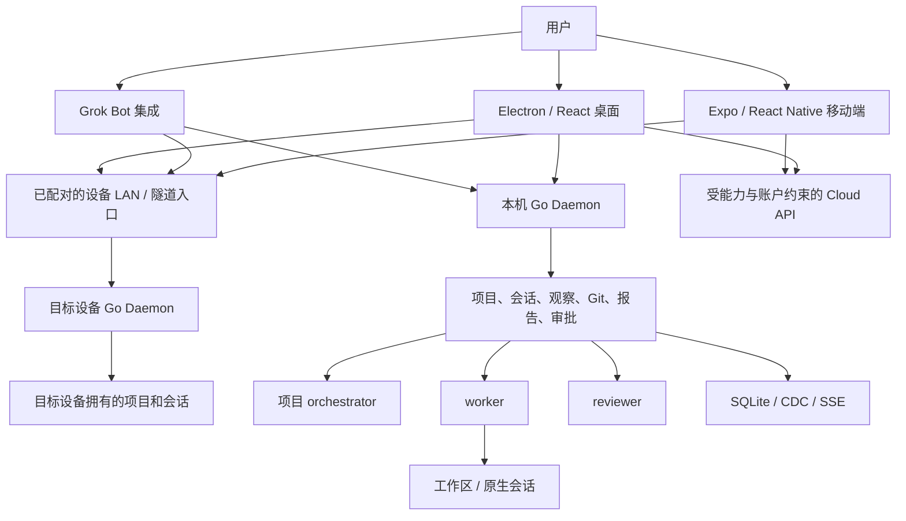

# Agent Orchestrator 源码调研

上游为 OrchestratorInc/agent-orchestrator，以下简称 AO。本地 checkout 固定在 `0d322ae188eff9ad41d50df634fbe78c0af552d2`。以此提交的公开仓库、路由、实现与测试源码为依据。上游 README 的功能宣称和 STATUS 的交付描述分别核对。此次未启动上游、运行测试、登录 Cloud、配对手机或在真实仓库执行 Git 写操作。测试文件证明仓库包含相应的回归断言。 [中文 README](https://github.com/OrchestratorInc/agent-orchestrator/blob/0d322ae188eff9ad41d50df634fbe78c0af552d2/translations/README.zh-CN.md) · [STATUS](https://github.com/OrchestratorInc/agent-orchestrator/blob/0d322ae188eff9ad41d50df634fbe78c0af552d2/docs/STATUS.md) · [文档与契约地图](https://github.com/OrchestratorInc/agent-orchestrator/blob/0d322ae188eff9ad41d50df634fbe78c0af552d2/docs/documentation-map.md)

## 功能地图

| 范围 | 公开源码中看到的能力 | 与 Muster 的直接关系 |
| --- | --- | --- |
| 桌面和移动端 | 项目、会话看板、工作区、通知、产物、自动化、用量、设置。移动端也有 Chat、终端、PR、Review 和预览入口 | 看板信息层级、详情页、需要人的入口 |
| Agent | 项目 orchestrator、worker、reviewer，工具与模型选择、就绪探测、账户、安装和版本管理 | 中心 dsh、项目上下文、设备上的 CLI、独立 Review |
| 执行与调度 | 手工与 agent 派活、启动恢复、后台队列、工作报告、计划任务、Issue 接入和重试约束 | 下发、续接、报告交付、重复执行控制 |
| 代码交付 | Git 工作区、Scratch、多个仓库、PR/CI/Review、依赖 PR、合并、侧挂终端 | 家中电脑修复、测试、可选验证、允许范围内推送 |
| 工件和开发工具 | Diff、搜索、历史导入、附件、Artifact、浏览器、页面渲染、MCP、Computer Use | 首版保留结果证据，复杂工具按以后需求评估 |
| 联网和运维 | 本地守护进程、设备配对、远程主机聚合、移动推送、Grok Bot、Cloud 客户端、日志、遥测、升级 | 主机身份、设备可达性、飞书审批、单机 VPS 运维 |

## 顶层结构

Go daemon 按 HTTP/CLI、service、ports、adapters 分层。本机桌面调用 loopback API，SQLite 保存业务事实，变化经 CDC 传给 SSE 和进程内订阅者。PTY/ConPTY、浏览器、预览和 provider host 有各自传输。桌面远程主机目录与 Cloud API 客户端分别接不同能力。Muster 可以保留 API、业务状态、设备执行三个边界。全局中心 dsh 作为单独节点，项目、设备 daemon、具体 Codex/dsh CLI 和 Review agent 都有独立身份和职责。 [架构](https://github.com/OrchestratorInc/agent-orchestrator/blob/0d322ae188eff9ad41d50df634fbe78c0af552d2/docs/architecture.md) · [后端分层](https://github.com/OrchestratorInc/agent-orchestrator/blob/0d322ae188eff9ad41d50df634fbe78c0af552d2/docs/backend-code-structure.md) · [API 路由](https://github.com/OrchestratorInc/agent-orchestrator/blob/0d322ae188eff9ad41d50df634fbe78c0af552d2/backend/internal/httpd/router.go) · [远程主机目录](https://github.com/OrchestratorInc/agent-orchestrator/blob/0d322ae188eff9ad41d50df634fbe78c0af552d2/backend/internal/daemon/remote_host_directory.go)

## 1. 入口、界面和展示

| 功能 | 实现与验证线索 | Muster 取舍 |
| --- | --- | --- |
| 全局工作区、项目与远程项目视图 | TanStack Router 的 `_shell` 下分别注册 sessions、new、project、host、automations、artifacts、usage、settings。远程路径显式包含 hostId，SessionView 有独立 remote 测试。渲染端通过生成的 OpenAPI TypeScript 合约访问 daemon。 [路由](https://github.com/OrchestratorInc/agent-orchestrator/tree/0d322ae188eff9ad41d50df634fbe78c0af552d2/frontend/src/renderer/routes) · [SessionView](https://github.com/OrchestratorInc/agent-orchestrator/blob/0d322ae188eff9ad41d50df634fbe78c0af552d2/frontend/src/renderer/components/SessionView.tsx) · [远程视图测试](https://github.com/OrchestratorInc/agent-orchestrator/blob/0d322ae188eff9ad41d50df634fbe78c0af552d2/frontend/src/renderer/components/SessionView.remote.test.tsx) · [客户端契约](https://github.com/OrchestratorInc/agent-orchestrator/blob/0d322ae188eff9ad41d50df634fbe78c0af552d2/frontend/src/api/schema.ts) | 保留主对话、任务看板、设备/项目/Agent 管理三个入口。看板全局可过滤到设备和项目，详情的深链带稳定 ID。 |
| 看板列、卡片和状态标签 | 前端读取会话与工作区，过滤 worker 并把归档单列。后端先把 session、当前 commit 对应的 review run、PR 和依赖关系转换为输入，再由纯函数给出 building、validating、needs_review、ready、archive 和卡片标签。AO 自己的 Review 与外部 Review 分开，叠加 PR 在上游合并前有独立判断。 [看板组件](https://github.com/OrchestratorInc/agent-orchestrator/blob/0d322ae188eff9ad41d50df634fbe78c0af552d2/frontend/src/renderer/components/SessionsBoard.tsx) · [事实映射](https://github.com/OrchestratorInc/agent-orchestrator/blob/0d322ae188eff9ad41d50df634fbe78c0af552d2/backend/internal/service/session/kanban.go) · [列归约](https://github.com/OrchestratorInc/agent-orchestrator/blob/0d322ae188eff9ad41d50df634fbe78c0af552d2/backend/pkg/contract/kanban.go) · [归约测试](https://github.com/OrchestratorInc/agent-orchestrator/blob/0d322ae188eff9ad41d50df634fbe78c0af552d2/backend/pkg/contract/kanban_test.go) | 首版采用“列 = 交付阶段，徽标 = 当前活动与阻塞原因”的方式。适配非 Git 任务、设备离线和未配置验证的任务。默认让待我处理可见。 |
| 任务工作区与操作面板 | SessionView 组合会话界面、工作区、文件、预览、Review、Artifacts 和操作。Chat 工作区独立处理历史窗口、重试和 worker 更新。移动端同样按 session mode 选择 Chat 或 xterm，并有相应的 Review、Files 与 Browser 路由。 [桌面任务界面](https://github.com/OrchestratorInc/agent-orchestrator/blob/0d322ae188eff9ad41d50df634fbe78c0af552d2/frontend/src/renderer/components/SessionView.tsx) · [Chat 工作区](https://github.com/OrchestratorInc/agent-orchestrator/blob/0d322ae188eff9ad41d50df634fbe78c0af552d2/frontend/src/renderer/components/chat/ChatWorkspace.tsx) · [历史窗口测试](https://github.com/OrchestratorInc/agent-orchestrator/blob/0d322ae188eff9ad41d50df634fbe78c0af552d2/frontend/src/renderer/components/chat/ChatWorkspace.history-window.test.tsx) · [移动路由](https://github.com/OrchestratorInc/agent-orchestrator/tree/0d322ae188eff9ad41d50df634fbe78c0af552d2/packages/mobile/app) | 任务详情最先显示目标、负责设备与 Agent、当前步骤、阻塞原因、测试、Review、push 回执和日志入口。终端控制和富 Chat 属于更大的交互面。 |
| Settings 分区与状态优先展示 | `settingsCatalog` 把 General、Harness、Teams、Billing、Browser Profiles、Computer Use、Coder、Remote Hosts、Mobile、Shortcuts、Diagnostics、Updates 与 Help 注册成可条件显示的配置页。诊断采样只在独立页面打开时开始。 [设置目录](https://github.com/OrchestratorInc/agent-orchestrator/blob/0d322ae188eff9ad41d50df634fbe78c0af552d2/frontend/src/renderer/components/settings/settingsCatalog.tsx) · [Harness UI](https://github.com/OrchestratorInc/agent-orchestrator/blob/0d322ae188eff9ad41d50df634fbe78c0af552d2/frontend/src/renderer/components/settings/HarnessSettingsSection.tsx) | 用设备、项目和 Agent 分区管理。某 Agent 先显示二进制、版本、认证和可用能力，再展示修复入口与最近检查时间。 |
| 通知、快捷键与外观 | 桌面通知按时间合并本地、远程和 Cloud 项，区分 PR 与会话跳转，提供已读、清空和 toast。键位、主题等属于应用级设置。 [通知中心](https://github.com/OrchestratorInc/agent-orchestrator/blob/0d322ae188eff9ad41d50df634fbe78c0af552d2/frontend/src/renderer/components/NotificationCenter.tsx) · [键位](https://github.com/OrchestratorInc/agent-orchestrator/blob/0d322ae188eff9ad41d50df634fbe78c0af552d2/frontend/src/main/keybinding-settings.ts) · [UI 设置](https://github.com/OrchestratorInc/agent-orchestrator/blob/0d322ae188eff9ad41d50df634fbe78c0af552d2/frontend/src/main/ui-settings.ts) | Web 任务看板承接日常状态，主对话接收汇报和请示。使用需答复、需检查、已完结等可行动含义。 |
| 派活草案、仓库和模型选择 | 创建任务的 UI 可先准备 worktree；服务用准备 token 与最终创建分离，可幂等取消。主创建请求接受 client request ID/hash，创建一个可定位 worker 后异步继续准备，标题提炼以低优先级后台工作处理。 [派活实现](https://github.com/OrchestratorInc/agent-orchestrator/blob/0d322ae188eff9ad41d50df634fbe78c0af552d2/backend/internal/service/session/delegation.go) · [准备与回收](https://github.com/OrchestratorInc/agent-orchestrator/blob/0d322ae188eff9ad41d50df634fbe78c0af552d2/backend/internal/session_manager/task_preparation.go) · [派活测试](https://github.com/OrchestratorInc/agent-orchestrator/blob/0d322ae188eff9ad41d50df634fbe78c0af552d2/backend/internal/service/session/delegation_test.go) | 指令接收后立即给任务 ID。明确区分“已受理”“已分配”“工作区就绪”“已启动”。标题失败对执行无影响。 |
| 项目快捷操作和 Cue | Cue service 将可复用提示词和本地命令分开存储。Agent Cue 可给同项目的可接收会话发提示词，也可新建 worker。Command Cue 只接受本地调用，交给独立工作区 shell。命令面板把任务动作、历史和文件搜索放到同一入口。 [Cue 调用](https://github.com/OrchestratorInc/agent-orchestrator/blob/0d322ae188eff9ad41d50df634fbe78c0af552d2/backend/internal/service/cue/invoke.go) · [Cue 测试](https://github.com/OrchestratorInc/agent-orchestrator/blob/0d322ae188eff9ad41d50df634fbe78c0af552d2/backend/internal/service/cue/service_test.go) · [命令面板](https://github.com/OrchestratorInc/agent-orchestrator/blob/0d322ae188eff9ad41d50df634fbe78c0af552d2/frontend/src/renderer/components/CommandPalette.tsx) | 可先沉淀项目级“修 bug”“测试”“独立 Review”模板，快捷入口仍经过正常任务权限和状态校验。 |

## 2. Agent、会话与运行控制

| 功能 | 实现与验证线索 | Muster 取舍 |
| --- | --- | --- |
| Orchestrator 与 worker 角色 | 项目可有专属 orchestrator 对话。CLI 提供 `spawn/send/report`，桌面委派入口也能经 `DelegateTask` 直接创建 worker。项目角色配置分别选 orchestrator、worker 和 reviewer 的 Agent/模型。 [角色配置](https://github.com/OrchestratorInc/agent-orchestrator/blob/0d322ae188eff9ad41d50df634fbe78c0af552d2/frontend/src/renderer/components/settings/ProjectAgentRoleControls.tsx) · [CLI](https://github.com/OrchestratorInc/agent-orchestrator/blob/0d322ae188eff9ad41d50df634fbe78c0af552d2/backend/internal/cli/root.go) · [委派](https://github.com/OrchestratorInc/agent-orchestrator/blob/0d322ae188eff9ad41d50df634fbe78c0af552d2/backend/internal/service/session/delegation.go) · [会话启动与角色](https://github.com/OrchestratorInc/agent-orchestrator/blob/0d322ae188eff9ad41d50df634fbe78c0af552d2/docs/architecture.md#session-spawn-flow) | 中心 dsh 建立全局唯一用户会话。项目与设备都可成为派发入口，授权和任务登记统一。明确普通设备 agent、项目协调 agent 与 Reviewer 所拥有的数据。 |
| Agent 能力、认证和模型 | worker、Chat driver、reviewer 各自独立注册。就绪协调器按用途主动刷新并归一化安装、版本与认证，模型发现有凭据作用域、输入指纹、缓存和合并并发请求。 [Worker 注册](https://github.com/OrchestratorInc/agent-orchestrator/tree/0d322ae188eff9ad41d50df634fbe78c0af552d2/backend/internal/adapters/agent/registry) · [Chat 注册](https://github.com/OrchestratorInc/agent-orchestrator/tree/0d322ae188eff9ad41d50df634fbe78c0af552d2/backend/internal/adapters/chatdriver/registry) · [Review 注册](https://github.com/OrchestratorInc/agent-orchestrator/blob/0d322ae188eff9ad41d50df634fbe78c0af552d2/backend/internal/adapters/reviewer/registry.go) · [就绪协调器](https://github.com/OrchestratorInc/agent-orchestrator/blob/0d322ae188eff9ad41d50df634fbe78c0af552d2/backend/internal/service/agent/readiness_coordinator.go) · [模型服务](https://github.com/OrchestratorInc/agent-orchestrator/blob/0d322ae188eff9ad41d50df634fbe78c0af552d2/backend/internal/service/agent/service.go) · [就绪测试](https://github.com/OrchestratorInc/agent-orchestrator/blob/0d322ae188eff9ad41d50df634fbe78c0af552d2/backend/internal/service/agent/readiness_coordinator_test.go) | 保留能力分表。明确记录 `submit`、`final_result`、`resume`、`usage` 和可选配置管理，未知能力单独显示。首版用原生命令参数和结构化输出约定。 |
| Chat / TUI 与持久化 | TUI 持有原生 PTY/ConPTY 或兼容 runtime，Chat 用 Codex app-server、ACP 等协议。Chat 把原始事件与消息、turn、activity、usage、approval 投影一起持久化。provider 账户/认证、模型、工具活动、附件、历史、队列、steer、rollback 都沿控制器能力进入。 [Chat 服务](https://github.com/OrchestratorInc/agent-orchestrator/tree/0d322ae188eff9ad41d50df634fbe78c0af552d2/backend/internal/service/chat) · [终端接口](https://github.com/OrchestratorInc/agent-orchestrator/blob/0d322ae188eff9ad41d50df634fbe78c0af552d2/backend/internal/httpd/terminal_mux.go) · [会话接口切换](https://github.com/OrchestratorInc/agent-orchestrator/blob/0d322ae188eff9ad41d50df634fbe78c0af552d2/backend/internal/session_manager/interface_transition.go) · [输入排队](https://github.com/OrchestratorInc/agent-orchestrator/blob/0d322ae188eff9ad41d50df634fbe78c0af552d2/backend/internal/service/chat/queue.go) | 原生 CLI 主接口只要求收 prompt、返回结果、同设备续接。保存调用、结果、native session ID 和可选证据。把厂商的富 Chat/TUI 投影和切换视为独立功能。 |
| 脱离宿主、休眠与唤醒 | Codex 和注册 ACP 的 detached host 可脱离桌面、被新版 daemon 接管在途 turn。视图 lease 与 controller gate 协作。空闲、无活动且 provider 原生 ID 已知时可休眠。唤醒经受控原生 resume，恢复中的并发请求等待同一次 wake。Chat/TUI 切换另有 drain/interrupt 和 controller generation。 [持久宿主](https://github.com/OrchestratorInc/agent-orchestrator/tree/0d322ae188eff9ad41d50df634fbe78c0af552d2/backend/internal/adapters/chatdriver/persistenthost) · [daemon 装配](https://github.com/OrchestratorInc/agent-orchestrator/blob/0d322ae188eff9ad41d50df634fbe78c0af552d2/backend/internal/daemon/persistent_chat_wiring.go) · [休眠](https://github.com/OrchestratorInc/agent-orchestrator/blob/0d322ae188eff9ad41d50df634fbe78c0af552d2/backend/internal/service/chat/hibernate.go) · [持久宿主测试](https://github.com/OrchestratorInc/agent-orchestrator/blob/0d322ae188eff9ad41d50df634fbe78c0af552d2/backend/internal/daemon/persistent_chat_wiring_test.go) | 原生 CLI 完成一轮后释放进程，等待状态保留本机 native ID、cwd、Agent 身份和前次退出结果。设备重连恢复待派、待答和可续会话。正在运行的进程单列重启恢复条件。 |
| 进程活性、停止、恢复与清理 | runtime reaper 定期观察，lifecycle manager 根据收到的运行事实更新。hook 带 launch ID，Chat 带 controller generation，旧事件按身份过滤。启动、停止 turn、终止 session、恢复 session、清理 workspace 有不同路径。进程存活检查另行约束原生进程身份与复用风险。 [Reaper](https://github.com/OrchestratorInc/agent-orchestrator/blob/0d322ae188eff9ad41d50df634fbe78c0af552d2/backend/internal/observe/reaper/reaper.go) · [生命周期](https://github.com/OrchestratorInc/agent-orchestrator/blob/0d322ae188eff9ad41d50df634fbe78c0af552d2/backend/internal/lifecycle/manager.go) · [进程身份](https://github.com/OrchestratorInc/agent-orchestrator/tree/0d322ae188eff9ad41d50df634fbe78c0af552d2/backend/internal/processalive) · [启动/清理](https://github.com/OrchestratorInc/agent-orchestrator/blob/0d322ae188eff9ad41d50df634fbe78c0af552d2/backend/internal/session_manager/manager.go) · [Reaper 测试](https://github.com/OrchestratorInc/agent-orchestrator/blob/0d322ae188eff9ad41d50df634fbe78c0af552d2/backend/internal/observe/reaper/reaper_test.go) | 首版区分停止本轮、取消任务与设备断联。对执行尝试使用有代次的租约。超时先记录并停止，超过宽限才结束进程树。终止或自动重试前核对设备上的实际状态。 |
| 对话审批、结构化问答、侧聊和历史 | Chat 控制路径分别维护 approval 和 structured input 的 request ID 与状态，消息、活动与 turn 分页读取。另有 side chat、会话 fork、原生外部历史 scan/import 与会话检索，提供工作区归属和原生身份校验。 [会话控制器](https://github.com/OrchestratorInc/agent-orchestrator/blob/0d322ae188eff9ad41d50df634fbe78c0af552d2/backend/internal/httpd/controllers/conversations.go) · [侧聊](https://github.com/OrchestratorInc/agent-orchestrator/blob/0d322ae188eff9ad41d50df634fbe78c0af552d2/backend/internal/service/chat/side.go) · [Fork](https://github.com/OrchestratorInc/agent-orchestrator/blob/0d322ae188eff9ad41d50df634fbe78c0af552d2/backend/internal/session_manager/session_fork.go) · [导入](https://github.com/OrchestratorInc/agent-orchestrator/blob/0d322ae188eff9ad41d50df634fbe78c0af552d2/backend/internal/service/sessionimport/service.go) · [检索](https://github.com/OrchestratorInc/agent-orchestrator/blob/0d322ae188eff9ad41d50df634fbe78c0af552d2/backend/internal/service/sessionsearch/service.go) | 首版让工作端生成明确的请示对象，Web/飞书写入同一记录。保存本地会话索引及结果摘要即可，历史导入、迁移、分叉、侧聊留待真实需求出现。 |
| 辅助终端与 shell 内 Agent | side shell、独立终端与 Agent 终端有不同生命期。shellterm、panes 路由和 mux 负责重连及面板控制，shellagent 服务识别辅助 shell 中的 Agent 活动。 [Shell 路由](https://github.com/OrchestratorInc/agent-orchestrator/blob/0d322ae188eff9ad41d50df634fbe78c0af552d2/backend/internal/httpd/controllers/shell_terminals.go) · [Panes 路由](https://github.com/OrchestratorInc/agent-orchestrator/blob/0d322ae188eff9ad41d50df634fbe78c0af552d2/backend/internal/httpd/controllers/panes.go) · [终端复用](https://github.com/OrchestratorInc/agent-orchestrator/blob/0d322ae188eff9ad41d50df634fbe78c0af552d2/docs/architecture.md#terminal-multiplexing) | 首版把人工诊断、Agent 主执行和测试子进程分开记账。用设备日志和进程管理满足基本排障，交互式远程 shell 单独评估。 |

## 3. 项目、工作区与日常交付

| 功能 | 实现与验证线索 | Muster 取舍 |
| --- | --- | --- |
| Git 项目、普通目录、多仓库 | Project service 根据路径、Git 根、仓库状态和项目类型登记。Workspace project 记录各子 repo，处理父目录与 Git 元数据。workspace router 按类型选择 gitworktree 或 scratch 适配。设置支持默认分支、项目角色、配置、权限和项目移除。 [项目登记](https://github.com/OrchestratorInc/agent-orchestrator/blob/0d322ae188eff9ad41d50df634fbe78c0af552d2/backend/internal/service/project/service.go) · [多仓库](https://github.com/OrchestratorInc/agent-orchestrator/blob/0d322ae188eff9ad41d50df634fbe78c0af552d2/backend/internal/service/project/workspace_registration.go) · [工作区路由](https://github.com/OrchestratorInc/agent-orchestrator/blob/0d322ae188eff9ad41d50df634fbe78c0af552d2/backend/internal/adapters/workspace/router/router.go) · [普通工作区](https://github.com/OrchestratorInc/agent-orchestrator/blob/0d322ae188eff9ad41d50df634fbe78c0af552d2/backend/internal/adapters/workspace/scratch/workspace.go) · [多仓库测试](https://github.com/OrchestratorInc/agent-orchestrator/blob/0d322ae188eff9ad41d50df634fbe78c0af552d2/backend/internal/service/project/workspace_registration_internal_test.go) | 稳定项目 ID 与设备本地路径分开。普通目录默认控制同目录写并发。Git 项目验证仓库身份，按任务建立明确工作区并保存起点和分支。多仓库事务语义可后续评估。 |
| 准备工作区、目录规则、脚本与故障 | session manager 使用 per-project gate 管理工作区。Git worktree 层处理工作树，创建流程记录阶段错误、任务预备、工作树文件纳入、清理和恢复。 [Git worktree](https://github.com/OrchestratorInc/agent-orchestrator/tree/0d322ae188eff9ad41d50df634fbe78c0af552d2/backend/internal/adapters/workspace/gitworktree) · [生命周期入口](https://github.com/OrchestratorInc/agent-orchestrator/blob/0d322ae188eff9ad41d50df634fbe78c0af552d2/backend/internal/session_manager/manager.go) · [纳入规则](https://github.com/OrchestratorInc/agent-orchestrator/blob/0d322ae188eff9ad41d50df634fbe78c0af552d2/backend/internal/session_manager/worktree_include.go) · [清理](https://github.com/OrchestratorInc/agent-orchestrator/blob/0d322ae188eff9ad41d50df634fbe78c0af552d2/backend/internal/session_manager/workspace_cleanup.go) | 创建前记录基线 commit、已选分支和工作目录。失败给出可重试阶段与清理状态。首次部署可把项目脚本定义为测试命令等清晰字段。 |
| 文件树、文件内容、Diff 和评论 | 后端从 session 对应工作区解析路径，生成 working、branch、commit 等范围的差异与版本指纹。文件内容带版本或 expected revision，未跟踪文件可生成新增 patch。前端 Review pane 消费文件 manifest 与修订。 [文件 API](https://github.com/OrchestratorInc/agent-orchestrator/blob/0d322ae188eff9ad41d50df634fbe78c0af552d2/backend/internal/service/session/workspace_files.go) · [差异服务](https://github.com/OrchestratorInc/agent-orchestrator/blob/0d322ae188eff9ad41d50df634fbe78c0af552d2/backend/internal/service/session/workspace_review.go) · [提交选择](https://github.com/OrchestratorInc/agent-orchestrator/blob/0d322ae188eff9ad41d50df634fbe78c0af552d2/backend/internal/service/session/workspace_selection.go) · [Review pane](https://github.com/OrchestratorInc/agent-orchestrator/blob/0d322ae188eff9ad41d50df634fbe78c0af552d2/frontend/src/renderer/components/diffs/WorkspaceReviewPane.tsx) · [差异测试](https://github.com/OrchestratorInc/agent-orchestrator/blob/0d322ae188eff9ad41d50df634fbe78c0af552d2/backend/internal/service/session/workspace_review_test.go) | 首版给用户测试摘要、变更文件、commit 和 PR 深链。评审机器使用稳定 commit 或可校验补丁。完整编辑器、任意提交对比和逐行批注等待使用反馈。 |
| PR 归属、观察和概览 | SCM observer 有独立扫描与 per-PR 刷新，适配 GitHub、GitLab，依赖稳定仓库身份、分支与 session 归属；GitHub 客户端按条件获取并进行语义变更检测。UI 用精简摘要显示 CI、未解决评论与 mergeability。PR claim 能认领已有分支的 PR。 [SCM observer](https://github.com/OrchestratorInc/agent-orchestrator/blob/0d322ae188eff9ad41d50df634fbe78c0af552d2/backend/internal/observe/scm/observer.go) · [归属测试](https://github.com/OrchestratorInc/agent-orchestrator/blob/0d322ae188eff9ad41d50df634fbe78c0af552d2/backend/internal/observe/scm/observer_attribution_test.go) · [PR 认领](https://github.com/OrchestratorInc/agent-orchestrator/blob/0d322ae188eff9ad41d50df634fbe78c0af552d2/backend/internal/service/session/claim_pr.go) · [摘要](https://github.com/OrchestratorInc/agent-orchestrator/blob/0d322ae188eff9ad41d50df634fbe78c0af552d2/backend/internal/service/session/pr_summary.go) | 首版可从任务自主 push 回执与可选 PR URL 开始。若后续增加 CI/Review observer，按 repo/PR/commit 绑定真实证据，旧事件只做历史。 |
| CI、评论和冲突自动反馈 | 生命周期分析失败 checks、Review 反馈、冲突，按 PR 与反馈内容签名去重，通过申明的项目策略发送给归属 worker。重试有限，障碍清除后可恢复冲突反馈。SCM observation 走相同生命周期入口。 [反应实现](https://github.com/OrchestratorInc/agent-orchestrator/blob/0d322ae188eff9ad41d50df634fbe78c0af552d2/backend/internal/lifecycle/reactions.go) · [自动修复说明](https://github.com/OrchestratorInc/agent-orchestrator/blob/0d322ae188eff9ad41d50df634fbe78c0af552d2/frontend/src/docs/content/guides/ci-recovery.mdx) · [生命周期测试](https://github.com/OrchestratorInc/agent-orchestrator/blob/0d322ae188eff9ad41d50df634fbe78c0af552d2/backend/internal/lifecycle/manager_test.go) | 首版让本地测试失败或独立 Review 有发现时返回原 worker 处理，限制轮次并展示最后失败证据。远端 CI、自动评论处理和冲突修复成为后续增量。 |
| 独立 Review、自动 Review 与结果约束 | Reviewer 入口经 review service 进入 core planner/launcher。auto-review 以有效会话、项目配置和当前 PR head 评估，依已有判决、取消、运行状态和重试次数去重。gateway 收拢 reviewer 可使用能力，配置表还区分实验 reviewer。 [Review 服务](https://github.com/OrchestratorInc/agent-orchestrator/blob/0d322ae188eff9ad41d50df634fbe78c0af552d2/backend/internal/service/review/review.go) · [Planner](https://github.com/OrchestratorInc/agent-orchestrator/blob/0d322ae188eff9ad41d50df634fbe78c0af552d2/backend/internal/review/planner.go) · [自动 Review 协调](https://github.com/OrchestratorInc/agent-orchestrator/blob/0d322ae188eff9ad41d50df634fbe78c0af552d2/backend/internal/autoreview/coordinator.go) · [Review gateway](https://github.com/OrchestratorInc/agent-orchestrator/blob/0d322ae188eff9ad41d50df634fbe78c0af552d2/backend/internal/reviewgateway/gateway.go) · [自动 Review 测试](https://github.com/OrchestratorInc/agent-orchestrator/blob/0d322ae188eff9ad41d50df634fbe78c0af552d2/backend/internal/autoreview/coordinator_test.go) | 用户可选同设备或另一设备的独立 Agent 验证明确版本。保存 reviewer、验证的 commit 或补丁哈希、判决和发现。发生新提交后旧结果退出当前验证，后续仍可查看。 |
| PR Action、合并检查和堆叠 | 合并先要求 PR 归属以及 expected head，核对追踪信息和刷新后实时 commit，再将 head 传给 SCM 接口。Stack service 另算 PR 依赖并以依赖和 head 约束执行。 [合并服务](https://github.com/OrchestratorInc/agent-orchestrator/blob/0d322ae188eff9ad41d50df634fbe78c0af552d2/backend/internal/service/pr/action_service.go) · [PR Stack](https://github.com/OrchestratorInc/agent-orchestrator/blob/0d322ae188eff9ad41d50df634fbe78c0af552d2/backend/internal/service/pr/stack.go) · [合并测试](https://github.com/OrchestratorInc/agent-orchestrator/blob/0d322ae188eff9ad41d50df634fbe78c0af552d2/backend/internal/service/pr/action_service_test.go) | 区分用户明确授权的自动 push、建 PR、合并。首版用项目允许的远端与任务分支及目标 SHA 做交付判定。push 超时先查远端实际值，再决定是否重试。 |
| Issue 接入 | tracker intake wiring 通过开关接入 GitHub/GitLab，按项目规则和身份发现待处理 Issue，经 observer 发起 worker。仓库 STATUS 描述当前 Issue 回写范围。 [接入装配](https://github.com/OrchestratorInc/agent-orchestrator/blob/0d322ae188eff9ad41d50df634fbe78c0af552d2/backend/internal/daemon/tracker_intake_wiring.go) · [接入观察器](https://github.com/OrchestratorInc/agent-orchestrator/blob/0d322ae188eff9ad41d50df634fbe78c0af552d2/backend/internal/observe/trackerintake/observer.go) · [观察测试](https://github.com/OrchestratorInc/agent-orchestrator/blob/0d322ae188eff9ad41d50df634fbe78c0af552d2/backend/internal/observe/trackerintake/observer_test.go) · [交付状态](https://github.com/OrchestratorInc/agent-orchestrator/blob/0d322ae188eff9ad41d50df634fbe78c0af552d2/docs/STATUS.md) | 首版主要由主对话下发。未来 Issue 触发复用相同任务创建 API，使用来源 ID 去重并根据设备、项目匹配条件确定是否接单。 |
| 项目迁移和外部资料导入 | 项目 clone 可预检并单独流式显示进展。公开实现还包含 GitHub 仓库导入和 devimport，文档有从 Conductor 迁移的独立路线。其项目导入与原生会话扫描不是同一数据操作。 [克隆服务](https://github.com/OrchestratorInc/agent-orchestrator/blob/0d322ae188eff9ad41d50df634fbe78c0af552d2/backend/internal/service/project/clone.go) · [仓库导入](https://github.com/OrchestratorInc/agent-orchestrator/blob/0d322ae188eff9ad41d50df634fbe78c0af552d2/backend/internal/service/importer/github.go) · [Dev import](https://github.com/OrchestratorInc/agent-orchestrator/blob/0d322ae188eff9ad41d50df634fbe78c0af552d2/backend/internal/service/devimport/service.go) · [迁移手册](https://github.com/OrchestratorInc/agent-orchestrator/blob/0d322ae188eff9ad41d50df634fbe78c0af552d2/frontend/src/docs/content/guides/migrate-from-conductor.mdx) | 首版基于设备上已有项目登记。需要远程 clone 时保留预检与接单分别显示、失败后保留路径和可恢复阶段。 |

## 4. 调度、报告、可靠性与通知

| 功能 | 实现与验证线索 | Muster 取舍 |
| --- | --- | --- |
| 定时规则、重启追赶和运行占用 | Automation 定义使用 RRULE、时区、project/harness/prompt，和单次 run 分开存储。启动先做 Reconcile，observer 定时 Tick，单条定义最多追赶 3 次。Claim 带 lease 且同定义只派一条，凭 AutomationRunID 找回已启动会话。 [自动化界面](https://github.com/OrchestratorInc/agent-orchestrator/blob/0d322ae188eff9ad41d50df634fbe78c0af552d2/frontend/src/renderer/components/AutomationsView.tsx) · [调度器](https://github.com/OrchestratorInc/agent-orchestrator/blob/0d322ae188eff9ad41d50df634fbe78c0af552d2/backend/internal/service/automation/scheduler.go) · [后台装配](https://github.com/OrchestratorInc/agent-orchestrator/blob/0d322ae188eff9ad41d50df634fbe78c0af552d2/backend/internal/daemon/automation_wiring.go) · [调度测试](https://github.com/OrchestratorInc/agent-orchestrator/blob/0d322ae188eff9ad41d50df634fbe78c0af552d2/backend/internal/service/automation/scheduler_test.go) | 首版先用单次任务。借鉴 definition/job 与 attempt 区别，启动、接单、超时和恢复独立留证。用户确立定时需求后加入规则与追赶策略。 |
| 一类重复失败的熔断 | tracker 与定时自动启动按项目/角色/Agent/模型/推理设置跟踪错误。相同连续失败三次后阻断自动触发，一段冷却后单探测，配置变化可重置。计数存于内存。 [熔断实现](https://github.com/OrchestratorInc/agent-orchestrator/blob/0d322ae188eff9ad41d50df634fbe78c0af552d2/backend/internal/service/session/auto_spawn_breaker.go) · [回归测试](https://github.com/OrchestratorInc/agent-orchestrator/blob/0d322ae188eff9ad41d50df634fbe78c0af552d2/backend/internal/service/session/auto_spawn_breaker_test.go) | 安装缺失、登录失效和设备离线各给明确原因。对自动重试按故障类型有限退避，重点防止短周期重复重启带来的重复写入。 |
| Worker 报告交付 | `ao report` 接收文本、状态与输出引用。服务校验 worker 身份后写持久记录。需要输入、卡住即时可投递，完成等短结算窗口并可在最后一个 worker 停工后提前成批送出。coordinator 有项目归属、claim、幂等批次和重试，支持将待报告附到下一轮用户消息。 [报告 CLI](https://github.com/OrchestratorInc/agent-orchestrator/blob/0d322ae188eff9ad41d50df634fbe78c0af552d2/backend/internal/cli/report.go) · [报告写入](https://github.com/OrchestratorInc/agent-orchestrator/blob/0d322ae188eff9ad41d50df634fbe78c0af552d2/backend/internal/service/report/service.go) · [协调器](https://github.com/OrchestratorInc/agent-orchestrator/blob/0d322ae188eff9ad41d50df634fbe78c0af552d2/backend/internal/service/report/coordinator.go) · [提前发送测试](https://github.com/OrchestratorInc/agent-orchestrator/blob/0d322ae188eff9ad41d50df634fbe78c0af552d2/backend/internal/service/report/coordinator_early_flush_test.go) | 报告单独入库与任务关联，分辨进度、结论和请示。定期进度看板可读，需用户判断的请示及时送主对话及飞书。主对话汇报从已核对的结论生成，显示原始证据。 |
| 持久事件和实时看板 | SQLite 写入触发 CDC，poller/broadcaster 向后台和 SSE 发事件。SSE 先订阅后补历史，通过 `Last-Event-ID` 和 seq 去重。缓冲溢出就断开让客户端恢复，游标越过当前头时客户端用下一次快照校准。长连接 emit heartbeat。 [存储与 CDC](https://github.com/OrchestratorInc/agent-orchestrator/blob/0d322ae188eff9ad41d50df634fbe78c0af552d2/docs/architecture.md#persistence-and-cdc) · [SSE](https://github.com/OrchestratorInc/agent-orchestrator/blob/0d322ae188eff9ad41d50df634fbe78c0af552d2/backend/internal/httpd/events.go) · [CDC 装配](https://github.com/OrchestratorInc/agent-orchestrator/blob/0d322ae188eff9ad41d50df634fbe78c0af552d2/backend/internal/daemon/cdc_wiring.go) · [事件测试](https://github.com/OrchestratorInc/agent-orchestrator/blob/0d322ae188eff9ad41d50df634fbe78c0af552d2/backend/internal/httpd/events_test.go) | 中心保存任务事实，Web 用初始快照和带序号的 SSE 增量恢复。设备上报的尝试代次和事件 ID 先去重再更新视图。Web 在线状态不能替代业务事件的持久化。 |
| 通知生命周期与移动推送 | notifier 补齐任务与 PR 内容，持久化后发布。需要输入、可合并、已合并或关闭用业务事件和 resolution 更新。移动推送由 dispatcher 发到 Expo，设备经注册与撤销管理。 [通知管理](https://github.com/OrchestratorInc/agent-orchestrator/blob/0d322ae188eff9ad41d50df634fbe78c0af552d2/backend/internal/notify/manager.go) · [通知测试](https://github.com/OrchestratorInc/agent-orchestrator/blob/0d322ae188eff9ad41d50df634fbe78c0af552d2/backend/internal/notify/manager_test.go) · [推送](https://github.com/OrchestratorInc/agent-orchestrator/blob/0d322ae188eff9ad41d50df634fbe78c0af552d2/backend/internal/push/dispatcher.go) · [移动设备控制器](https://github.com/OrchestratorInc/agent-orchestrator/blob/0d322ae188eff9ad41d50df634fbe78c0af552d2/backend/internal/httpd/controllers/mobile_devices.go) | Web 和飞书通知引用同一审批及任务 ID。打开、已读、审批结论、消息投递状态各自独立。任意一端已处理，另一端打开即看到相同结论。 |

## 5. 远程主机、IM 与 Cloud

| 功能 | 实现与验证线索 | Muster 取舍 |
| --- | --- | --- |
| Connect Mobile 与可撤销设备身份 | 保持主 loopback listener，另开经过鉴权的 LAN listener。配对码、端点 offer 和 host identity verification 通向设备凭据。另有 cloudflared／Tailscale 安全端点、设备撤销及支持平台受限的 keep-awake。直接 LAN 模式使用明文传输。 [远程入口](https://github.com/OrchestratorInc/agent-orchestrator/blob/0d322ae188eff9ad41d50df634fbe78c0af552d2/backend/internal/httpd/lan_listener.go) · [配对与状态](https://github.com/OrchestratorInc/agent-orchestrator/blob/0d322ae188eff9ad41d50df634fbe78c0af552d2/backend/internal/httpd/controllers/mobile.go) · [身份](https://github.com/OrchestratorInc/agent-orchestrator/blob/0d322ae188eff9ad41d50df634fbe78c0af552d2/backend/internal/mobilebridge/identity.go) · [配对码](https://github.com/OrchestratorInc/agent-orchestrator/blob/0d322ae188eff9ad41d50df634fbe78c0af552d2/backend/internal/mobilebridge/pairingcodes.go) · [移动入口](https://github.com/OrchestratorInc/agent-orchestrator/blob/0d322ae188eff9ad41d50df634fbe78c0af552d2/packages/mobile/app/pair.tsx) | 借鉴稳定 host ID、一次性配对与撤销、可达性自检。Muster 的普通设备出站到中心，管理 UI 能呈现 Agent 与项目位置。对设备间直传单独定义授权、完整性、失败和重试。 |
| 远程主机目录与多机聚合 | AO public client 知道每台设备的 host ID 与可用地址。设备可以发布变化的 secure tunnel 地址，实际请求由客户端直达目标 daemon。设置页与通知流都跨 host 聚合。已有会话、文件、终端等能力受入口路由权限约束。 [地址发布](https://github.com/OrchestratorInc/agent-orchestrator/blob/0d322ae188eff9ad41d50df634fbe78c0af552d2/backend/internal/daemon/remote_host_directory.go) · [远程设置](https://github.com/OrchestratorInc/agent-orchestrator/blob/0d322ae188eff9ad41d50df634fbe78c0af552d2/frontend/src/renderer/components/settings/RemoteHostsSettings.tsx) · [远程 hooks](https://github.com/OrchestratorInc/agent-orchestrator/blob/0d322ae188eff9ad41d50df634fbe78c0af552d2/frontend/src/renderer/hooks/useRemoteHosts.ts) · [远程通知测试](https://github.com/OrchestratorInc/agent-orchestrator/blob/0d322ae188eff9ad41d50df634fbe78c0af552d2/frontend/src/renderer/components/NotificationCenter.remote.test.tsx) | 设备身份独立于内网 IP、机器昵称和公网连接。中心可以聚合事实，native session ID 始终和原设备/Agent 实例配对。AO 的直达 daemon 模式给设备边界参考。 |
| Grok Bot IM 入口 | 仓库提供 setup、status、orchestrator、answer、actions、update 和 rules 七个 skill，调用 AO CLI/API 处理本地、多主机及远程发现。答案按 host/session/request 路由，发原始 decision ID 或结构化输入到 worker，二次答复得到已失效/已处理状态。也用轮询和启发式发现正文问题。 [集成概览与上游实测表](https://github.com/OrchestratorInc/agent-orchestrator/blob/0d322ae188eff9ad41d50df634fbe78c0af552d2/integrations/grok-bot/README.md) · [审批和问答](https://github.com/OrchestratorInc/agent-orchestrator/blob/0d322ae188eff9ad41d50df634fbe78c0af552d2/integrations/grok-bot/skills/ao-answer/SKILL.md) · [编排](https://github.com/OrchestratorInc/agent-orchestrator/blob/0d322ae188eff9ad41d50df634fbe78c0af552d2/integrations/grok-bot/skills/ao-orchestrator/SKILL.md) | 复用审批路由与幂等响应。飞书使用中心发送明确事件和审批卡片，回调验证身份、任务、请求、代次和过期，点完同步 Web。用户要求 IM 仅作请示推送和回复，Grok Bot 的浏览、派活、合并、远程控制属于额外能力。 |
| 通用 Webhook | 上游手册保留旧 notifier URL 并清楚标注新版 Go CLI 的 webhook 不可用。Grok Bot README 也记录目前通过轮询感知状态。 [Webhook 手册](https://github.com/OrchestratorInc/agent-orchestrator/blob/0d322ae188eff9ad41d50df634fbe78c0af552d2/frontend/src/docs/content/plugins/notifiers/webhook.mdx) · [Grok Bot 限制](https://github.com/OrchestratorInc/agent-orchestrator/blob/0d322ae188eff9ad41d50df634fbe78c0af552d2/integrations/grok-bot/README.md) | 飞书需要 Muster 自己的发送器和回调。AO 的通知落库、语义去重和身份关联可以直接转成设计约束。 |
| Cloud 工作区、企业接入和分享 | 公开仓库包括 Cloud 控制面 OpenAPI、TS 客户端、用户 token 和 worker token、bootstrap/heartbeat、fenced turn、审查、工作区、终端和分享等客户端路径。客户端构建、账号 entitlement、组织 capability 影响入口。Cloud 服务端位于独立私有 submodule，当前 checkout 只看到 gitlink。 [Cloud 契约](https://github.com/OrchestratorInc/agent-orchestrator/blob/0d322ae188eff9ad41d50df634fbe78c0af552d2/contracts/cloud/openapi.yaml) · [客户端边界](https://github.com/OrchestratorInc/agent-orchestrator/blob/0d322ae188eff9ad41d50df634fbe78c0af552d2/packages/cloud-client/README.md) · [Cloud 状态](https://github.com/OrchestratorInc/agent-orchestrator/blob/0d322ae188eff9ad41d50df634fbe78c0af552d2/docs/STATUS.md) · [submodule](https://github.com/OrchestratorInc/agent-orchestrator/blob/0d322ae188eff9ad41d50df634fbe78c0af552d2/.gitmodules) | 只引入轻量的接入票据、稳定设备身份和事件代次。托管工作区、账户组织、公开分享与团队计费是独立产品模块。 |

## 6. Artifact、浏览器及工具入口

| 功能 | 实现与验证线索 | Muster 取舍 |
| --- | --- | --- |
| 文件附件、引用与运行记录 | 装配层对上传、暂存与 send 支持独立限额和入口，文件引用根据调用与工作区解析。Chat timeline 按持久消息和活动展示附件、变更、计划和命令。 [上传与 HTTP 限额](https://github.com/OrchestratorInc/agent-orchestrator/blob/0d322ae188eff9ad41d50df634fbe78c0af552d2/backend/internal/httpd/api.go) · [服务文件引用](https://github.com/OrchestratorInc/agent-orchestrator/blob/0d322ae188eff9ad41d50df634fbe78c0af552d2/backend/internal/service/session/file_reference.go) · [附件存储](https://github.com/OrchestratorInc/agent-orchestrator/tree/0d322ae188eff9ad41d50df634fbe78c0af552d2/backend/internal/attachmentstore) · [Chat UI](https://github.com/OrchestratorInc/agent-orchestrator/tree/0d322ae188eff9ad41d50df634fbe78c0af552d2/frontend/src/renderer/components/chat) | 首版支持任务输入附件和结果证据的引用及大小限制。按对象授权控制设备间传递，传输后核验哈希。 |
| 产物图库、会话 Artifact 和版本 | Artifact 可注册为 session 输出，UI 有会话与跨工作区视图、缩略图、预览、置顶和版本历史。backend `artifactversions` 捕获文件、保存 blob、记录 turn manifest，另有删除测试。Cloud 分享有单独路径。 [Artifact 页面](https://github.com/OrchestratorInc/agent-orchestrator/blob/0d322ae188eff9ad41d50df634fbe78c0af552d2/frontend/src/renderer/components/ArtifactsView.tsx) · [注册](https://github.com/OrchestratorInc/agent-orchestrator/blob/0d322ae188eff9ad41d50df634fbe78c0af552d2/backend/internal/service/session/artifact_registration.go) · [版本捕获](https://github.com/OrchestratorInc/agent-orchestrator/blob/0d322ae188eff9ad41d50df634fbe78c0af552d2/backend/internal/artifactversions/capture.go) · [版本清单](https://github.com/OrchestratorInc/agent-orchestrator/blob/0d322ae188eff9ad41d50df634fbe78c0af552d2/backend/internal/artifactversions/turn_manifest.go) · [捕获测试](https://github.com/OrchestratorInc/agent-orchestrator/blob/0d322ae188eff9ad41d50df634fbe78c0af552d2/backend/internal/artifactversions/capture_test.go) | 直接采用结果清单，将产物路径、类型、哈希和关联执行尝试作为 Task Result 的证据。图库、发布服务和跨工作区分享按需增加。 |
| 应用 Preview 和 Browser | Preview manager 按明确的 session target 管理本地开发服务器，Browser 用 Electron scoped WebContentsView 和 daemon broker 绑定目标。桌面负责浏览器配置与 DevTools。仓库另有 Chrome 扩展，包含会话、用户同意与执行模块。 [预览进程](https://github.com/OrchestratorInc/agent-orchestrator/blob/0d322ae188eff9ad41d50df634fbe78c0af552d2/backend/internal/previewserver/manager.go) · [浏览器 broker](https://github.com/OrchestratorInc/agent-orchestrator/blob/0d322ae188eff9ad41d50df634fbe78c0af552d2/backend/internal/browserruntime/broker.go) · [目标权限](https://github.com/OrchestratorInc/agent-orchestrator/blob/0d322ae188eff9ad41d50df634fbe78c0af552d2/backend/internal/service/browser/authority.go) · [桌面 runtime](https://github.com/OrchestratorInc/agent-orchestrator/blob/0d322ae188eff9ad41d50df634fbe78c0af552d2/frontend/src/main/agent-browser-runtime.ts) · [扩展](https://github.com/OrchestratorInc/agent-orchestrator/tree/0d322ae188eff9ad41d50df634fbe78c0af552d2/frontend/src/browser-extension) | 首版可以展示执行者已生成的截图和链接。若以后增加 Preview，绑定设备、任务和有效期。 |
| MCP、原生自动化和辅助操作 | `ao` 使用 Cobra 暴露 project、session、spawn、send、report、review、pr、automation、search、pane、render、preview、browser、doctor 等命令。MCP stdio 单独提供 HTML 渲染和可选 CUA 工具，经 daemon 调用。系统级 computer-use 也有独立服务和权限。 [命令注册](https://github.com/OrchestratorInc/agent-orchestrator/blob/0d322ae188eff9ad41d50df634fbe78c0af552d2/backend/internal/cli/root.go) · [MCP server](https://github.com/OrchestratorInc/agent-orchestrator/blob/0d322ae188eff9ad41d50df634fbe78c0af552d2/backend/internal/mcpserver/server.go) · [Computer Use](https://github.com/OrchestratorInc/agent-orchestrator/blob/0d322ae188eff9ad41d50df634fbe78c0af552d2/backend/internal/service/computeruse/computeruse.go) | 给中心和设备 agent 提供无状态调用能力，优先保留派发、报告、查询、请示、接收决策。系统级桌面操作是单独产品能力。 |

## 7. 管理、用量与维护

| 功能 | 实现与验证线索 | Muster 取舍 |
| --- | --- | --- |
| Agent 安装来源、升级、运行中避免替换 | daemon 先分析安装方法和当前二进制所属包管理器，然后生成安装更新计划。后台 job 可观测进度和目标版本，按 harness 设执行 gate。idle update 等相关会话可恢复后释放进程，随后更新并恢复。 [安装计划](https://github.com/OrchestratorInc/agent-orchestrator/blob/0d322ae188eff9ad41d50df634fbe78c0af552d2/backend/internal/service/systeminstall/agentplans.go) · [包归属](https://github.com/OrchestratorInc/agent-orchestrator/blob/0d322ae188eff9ad41d50df634fbe78c0af552d2/backend/internal/service/systeminstall/package_owner.go) · [空闲更新](https://github.com/OrchestratorInc/agent-orchestrator/blob/0d322ae188eff9ad41d50df634fbe78c0af552d2/backend/internal/service/systeminstall/update_when_idle.go) · [验证测试](https://github.com/OrchestratorInc/agent-orchestrator/blob/0d322ae188eff9ad41d50df634fbe78c0af552d2/backend/internal/service/systeminstall/update_when_idle_test.go) | 首版用少量受支持 Agent 和每种平台明确安装来源。升级前显示实际路径、现有版本、目标版本与占用任务，更新后重跑版本与恢复能力探测。 |
| Agent 配置、账号与日志 | AO 对 model/effort、运行权限、登录状态、配置读写、凭据 scope 和 Codex 多账户有分别的服务。故障诊断有本地日志、就绪原因和 `ao doctor`、`ao triage` 命令。 [Codex 账户](https://github.com/OrchestratorInc/agent-orchestrator/blob/0d322ae188eff9ad41d50df634fbe78c0af552d2/backend/internal/service/agent/codex_account_service.go) · [认证诊断](https://github.com/OrchestratorInc/agent-orchestrator/blob/0d322ae188eff9ad41d50df634fbe78c0af552d2/backend/internal/service/agent/auth_diagnostics.go) · [日志文件](https://github.com/OrchestratorInc/agent-orchestrator/blob/0d322ae188eff9ad41d50df634fbe78c0af552d2/backend/internal/daemon/log_file.go) · [doctor](https://github.com/OrchestratorInc/agent-orchestrator/blob/0d322ae188eff9ad41d50df634fbe78c0af552d2/backend/internal/cli/doctor.go) · [triage](https://github.com/OrchestratorInc/agent-orchestrator/blob/0d322ae188eff9ad41d50df634fbe78c0af552d2/backend/internal/cli/triage.go) | 设备保管凭据，中心显示运行参数、来源和认证结果。dangling 进程、持续失败和登录过期提供可定位日志。首版可按 Agent 和操作管理配置。 |
| Token、缓存、成本和资源诊断 | native 事件、hook 以及 transcript 文件可成为 usage 输入。collector 识别 native session、原生文件、续接和去重，再由 report reader 按时区、项目、模型和价格快照聚合。内存诊断另行采样。 [用量采集](https://github.com/OrchestratorInc/agent-orchestrator/blob/0d322ae188eff9ad41d50df634fbe78c0af552d2/backend/internal/service/usage/collector.go) · [用量报告](https://github.com/OrchestratorInc/agent-orchestrator/blob/0d322ae188eff9ad41d50df634fbe78c0af552d2/backend/internal/service/usage/report.go) · [续接测试](https://github.com/OrchestratorInc/agent-orchestrator/blob/0d322ae188eff9ad41d50df634fbe78c0af552d2/backend/internal/service/usage/collector_continuation_test.go) · [内存诊断](https://github.com/OrchestratorInc/agent-orchestrator/blob/0d322ae188eff9ad41d50df634fbe78c0af552d2/backend/internal/service/usage/memory.go) | 按每轮和每尝试记录调用方、来源、模型、输入、输出、cache 与估算成本，可缺省。无数据和零用量要分开展示。 |
| daemon 重启、安全升级与契约漂移 | 桌面监督和升级流程有启动/重启测试。daemon 能发布健康检查和 readiness，保留日志并按数据目录实例约束。OpenAPI 和 SQLite 代码生成有漂移检查。 [重启监督](https://github.com/OrchestratorInc/agent-orchestrator/blob/0d322ae188eff9ad41d50df634fbe78c0af552d2/frontend/src/main/daemon-auto-restart.ts) · [重启测试](https://github.com/OrchestratorInc/agent-orchestrator/blob/0d322ae188eff9ad41d50df634fbe78c0af552d2/frontend/src/main/daemon-auto-restart.integration.test.ts) · [更新](https://github.com/OrchestratorInc/agent-orchestrator/blob/0d322ae188eff9ad41d50df634fbe78c0af552d2/frontend/src/main/auto-updater.ts) · [daemon 状态](https://github.com/OrchestratorInc/agent-orchestrator/blob/0d322ae188eff9ad41d50df634fbe78c0af552d2/backend/internal/httpd/router.go) · [代码生成约束](https://github.com/OrchestratorInc/agent-orchestrator/blob/0d322ae188eff9ad41d50df634fbe78c0af552d2/docs/documentation-map.md) · [CI 工作流](https://github.com/OrchestratorInc/agent-orchestrator/tree/0d322ae188eff9ad41d50df634fbe78c0af552d2/.github/workflows) | 中心用轻量健康检查，设备升级先 drain 并保留会话恢复信息。只在已知版本支持的前提下接单。2C2G 的可用性要由 Muster 自己的任务量与保留策略验证。 |
| 发布、隐私、故障报告 | README 称跨平台桌面发布和限量遥测，源码有 telemetry identity、配置和问题报告入口。文档覆盖清单维护已做的本地验收与未验证平台。 [产品说明](https://github.com/OrchestratorInc/agent-orchestrator/blob/0d322ae188eff9ad41d50df634fbe78c0af552d2/README.md#product-telemetry) · [指标设置装配](https://github.com/OrchestratorInc/agent-orchestrator/blob/0d322ae188eff9ad41d50df634fbe78c0af552d2/backend/internal/daemon/telemetry_wiring.go) · [问题报告界面](https://github.com/OrchestratorInc/agent-orchestrator/blob/0d322ae188eff9ad41d50df634fbe78c0af552d2/frontend/src/renderer/components/settings/ReportProblemContent.tsx) · [文档覆盖](https://github.com/OrchestratorInc/agent-orchestrator/blob/0d322ae188eff9ad41d50df634fbe78c0af552d2/docs/documentation-coverage.md) | 自部署版汇总用户自己的运行信息，支持诊断包和清晰的日志保留策略。 |

## 首版落点与验收

1. **中心 dsh 和任务记录分开。** 中心理解目的并下发，接收等待处理与结案。每个任务保存项目、设备、原生 Agent、工作目录、尝试代次和外部身份。Web 用同一份任务事实生成列、活动与详情。把派活参数与用户已经授权的自动测试、Review、push 写进任务。
2. **派发到家中电脑。** 设备检查本地项目、仓库身份、Git 工作区和 Codex 可用性。设备停机时任务可等待，断线后恢复原任务；中心在未确认设备状态时展示等待核对。Worktree 与 session 回执分离，准备完成后再启动。
3. **测试和独立 Review 绑定内容。** worker 实际执行测试并给退出码。启用 Review 时，第二 Agent 验证明确版本。已有发现返回原 worker，达到限额或超出任务授权时形成请示。push 记录远端、引用和实际 SHA。
4. **完成报告来源可追溯。** 结案汇报含结果、改动、测试、Review、push 和链接。请示生成独立记录，主对话和飞书引用同一 request ID。模拟 Web 与飞书同时答复、设备断开、push 回执丢失、Review 后 commit 变化，以及中心重启后事件重放。
5. **分清后续候选。** GitHub/GitLab 自动观察、按 Issue 自动触发、计划任务、完整 Artifact 预览、浏览器与远程终端均可复用任务与设备边界。Cloud、富 Chat 控制器、跨接口历史转换与多账户商业管理各自评估维护成本。

AO 的调研据此支持三个优先判断。第一，worker 报告机制比把所有执行流塞进聊天更贴合单主对话。第二，运行状况与交付状态由不同事实产生，Git 审查和测试必须跟随被验证版本。第三，设备级身份、运行代次和通知请求 ID 能把续接、重复派发和跨端审批分别处理。AO 的公开 checkout 提供机制与测试线索，Cloud 服务端、上游真实设备行为和本设计的资源目标需要独立验收。
