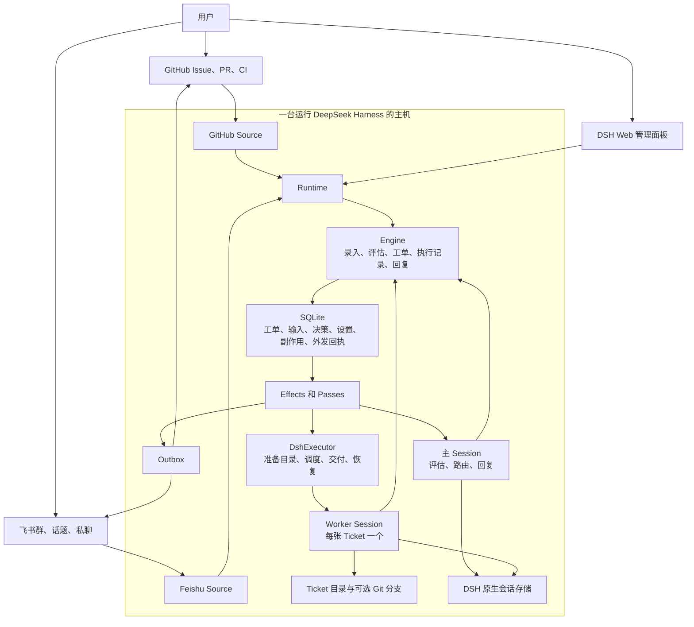

# dsh-superagent-prototype 源码调研

本地源码为 `.upstream/dsh-superagent-prototype`，分支 `main`，提交 `8c32a9dc5d72c033816c6a8110b37f40cf94fba4`，共 216 个跟踪项。以入口、来源注册、领域命令、管理 API、前端路由和回归用例为范围。所引测试为源码中的断言。真实模型、GitHub 和飞书联调未执行。 [概览](https://github.com/deepseek-ai/dsh-superagent-prototype/blob/8c32a9dc5d72c033816c6a8110b37f40cf94fba4/README.md) · [包依赖](https://github.com/deepseek-ai/dsh-superagent-prototype/blob/8c32a9dc5d72c033816c6a8110b37f40cf94fba4/package.json) · [MIT 许可](https://github.com/deepseek-ai/dsh-superagent-prototype/blob/8c32a9dc5d72c033816c6a8110b37f40cf94fba4/LICENSE)

## 1. 职责与数据

原型以一个 GitHub 仓库、一组来源账户和一个 DSH 主机为部署单位。GitHub 和飞书承载用户原始沟通。DSH Web 面板提供运营视图，并可打开主 Session 和 Worker Session。 `Trigger` 表示收到的消息或事件，`Evaluation` 和 `Decision` 保存裁决，`Ticket` 表示一项工作，`Assignment` 表示一次开始或接手。 `Thread` 表示可订阅的讨论，`Channel` 保存消息回到哪儿。 [领域对象](https://github.com/deepseek-ai/dsh-superagent-prototype/blob/8c32a9dc5d72c033816c6a8110b37f40cf94fba4/src/core/model.ts) · [装配](https://github.com/deepseek-ai/dsh-superagent-prototype/blob/8c32a9dc5d72c033816c6a8110b37f40cf94fba4/src/app/runtime.ts#L87-L169)

| 功能 | 源码实现 | Muster 取舍 |
| --- | --- | --- |
| 运行时与入口 | Cordis bundle 注入 DSH agents、Session Controller、持久化、workspace、权限、工具、系统提示词、模型、Web 和 subprocess。初始化先锁状态目录和注册本地管理接口，通过 setup 后才安装执行器 hooks、重新接手工单和启动副作用队列。 [插件入口](https://github.com/deepseek-ai/dsh-superagent-prototype/blob/8c32a9dc5d72c033816c6a8110b37f40cf94fba4/src/index.ts) · [Bundle](https://github.com/deepseek-ai/dsh-superagent-prototype/blob/8c32a9dc5d72c033816c6a8110b37f40cf94fba4/cordis.patch.yml) · [运行时](https://github.com/deepseek-ai/dsh-superagent-prototype/blob/8c32a9dc5d72c033816c6a8110b37f40cf94fba4/src/app/runtime.ts#L198-L249) | 借角色职责。Muster 中心 dsh、中心服务、设备 daemon、设备 dsh 和 Codex 是不同节点。原型直接访问 Harness 服务的代码属于其 bundle 部署。 |
| 领域命令 | Engine 将录入、评估、工单、Assignment、回复委托给对应领域类，通过接口分隔来源、管理、人类、Session、执行器和设置。来源无法直接写成一次无授权的接受。 [门面](https://github.com/deepseek-ai/dsh-superagent-prototype/blob/8c32a9dc5d72c033816c6a8110b37f40cf94fba4/src/core/engine.ts) · [角色接口](https://github.com/deepseek-ai/dsh-superagent-prototype/blob/8c32a9dc5d72c033816c6a8110b37f40cf94fba4/src/core/ports.ts) | 中心负责意图，服务检查设备和权限，daemon 只领取所承办的运行。 |
| 稳定身份 | Trigger 按源对象构造 ID，Thread 用 source:id，Decision、Ticket 由 Eval 派生，重试产生新 Assignment。Worker 使用 worker-加 ticket ID，主 Session ID 在数据库保存。 [对象和关联](https://github.com/deepseek-ai/dsh-superagent-prototype/blob/8c32a9dc5d72c033816c6a8110b37f40cf94fba4/src/core/model.ts) · [决策入账](https://github.com/deepseek-ai/dsh-superagent-prototype/blob/8c32a9dc5d72c033816c6a8110b37f40cf94fba4/src/core/evals.ts#L282-L339) · [运行时配对](https://github.com/deepseek-ai/dsh-superagent-prototype/blob/8c32a9dc5d72c033816c6a8110b37f40cf94fba4/src/executor/dsh.ts#L23-L26) | 明确 taskId、runId、inputId 和原生 sessionId 的关联，原生 ID 取设备返回值。 |
| 授权依据 | Mandate 保存发起身份、明确或推断、准入格或来源、匹配规则、范围及 Policy 版本，Decision 另存理由和评估审计。 [Mandate](https://github.com/deepseek-ai/dsh-superagent-prototype/blob/8c32a9dc5d72c033816c6a8110b37f40cf94fba4/src/core/model.ts#L96-L160) · [实际落账](https://github.com/deepseek-ai/dsh-superagent-prototype/blob/8c32a9dc5d72c033816c6a8110b37f40cf94fba4/src/core/evals.ts#L305-L339) | 保存设备、目录、CLI 配置档及项目规则版本。推送或独立验证可由同一授权记录解释。 |

## 2. 来源、准入和任务决策

| 功能 | 源码实现 | Muster 取舍 |
| --- | --- | --- |
| 来源扩展 | SourceKind 定义配置、显示字段、scope、health、Channel、上下文、搜索、策略、成员同步和执行变量。Registry 识别已安装、启用、保存配置，并保留未装的配置。Cookbook 给逐步的来源接入和测试规范。 [契约](https://github.com/deepseek-ai/dsh-superagent-prototype/blob/8c32a9dc5d72c033816c6a8110b37f40cf94fba4/src/sources/kind.ts) · [注册表](https://github.com/deepseek-ai/dsh-superagent-prototype/blob/8c32a9dc5d72c033816c6a8110b37f40cf94fba4/src/sources/registry.ts) · [接入指南](https://github.com/deepseek-ai/dsh-superagent-prototype/blob/8c32a9dc5d72c033816c6a8110b37f40cf94fba4/docs/008-cookbook.md) | 首版 Web 接任务和 Web／飞书审批。后续扩展可沿入站、出站分工。 |
| GitHub 通知与订阅轮询 | 一轮污染隔离为通知、仓库流、Ticket PR 和订阅线程。通知分页并服从 GitHub 间隔。每个 Issue 或 PR 独立读取，失败进重读表，通知失败仍检查 PR 与订阅线程。已订阅线程保留两周近期跟进窗口。 [轮询](https://github.com/deepseek-ai/dsh-superagent-prototype/blob/8c32a9dc5d72c033816c6a8110b37f40cf94fba4/src/sources/github.ts#L124-L177) · [通知路径](https://github.com/deepseek-ai/dsh-superagent-prototype/blob/8c32a9dc5d72c033816c6a8110b37f40cf94fba4/src/sources/github.ts#L279-L376) · [订阅窗口](https://github.com/deepseek-ai/dsh-superagent-prototype/blob/8c32a9dc5d72c033816c6a8110b37f40cf94fba4/src/sources/poll.ts) | 接项目级 GitHub 自动事件时，保留游标和逐项重试。初版手动请求即可触发完整 Git 交付。 |
| GitHub 仓库流 | 新 Issue、PR、普通评论和行评论各按配置范围摄入。开启时间和历史区间限制回补。最新游标留 5 秒重叠，Trigger ID 去重，游标不动可送 ETag。过滤自身账号，按账号、事件类型和 @ 生成来源元数据。 [仓库流](https://github.com/deepseek-ai/dsh-superagent-prototype/blob/8c32a9dc5d72c033816c6a8110b37f40cf94fba4/src/sources/github.ts#L179-L248) · [映射](https://github.com/deepseek-ai/dsh-superagent-prototype/blob/8c32a9dc5d72c033816c6a8110b37f40cf94fba4/src/sources/github-trigger.ts) | 未来增加外部任务源可借重复安全设计。 |
| CI 和评审触发 | GitHub 轮询 PR 详情、CI 检查、评论和评审。默认分支首次只记观察基线，失败集合发生变化或确定恢复才产生事件。无正文的审批状态能唤醒等待评审的工单。 [默认分支 CI](https://github.com/deepseek-ai/dsh-superagent-prototype/blob/8c32a9dc5d72c033816c6a8110b37f40cf94fba4/src/sources/github.ts#L251-L278) · [PR 与检查](https://github.com/deepseek-ai/dsh-superagent-prototype/blob/8c32a9dc5d72c033816c6a8110b37f40cf94fba4/src/sources/github.ts#L376-L459) · [空正文用例](https://github.com/deepseek-ai/dsh-superagent-prototype/blob/8c32a9dc5d72c033816c6a8110b37f40cf94fba4/tests/sources.spec.ts#L534-L547) | CI 状态做输入事实。用户要求的本地测试和独立 Review 则应跟同一待推 commit 记录。 |
| GitHub 失败呈现 | 404 可以重读，410 当删除，长时间反复失败的通知有弃读门槛。轮询连续失败到阈值才抬升健康异常，跳过的坏输入记录条数。 [错误处理](https://github.com/deepseek-ai/dsh-superagent-prototype/blob/8c32a9dc5d72c033816c6a8110b37f40cf94fba4/src/sources/github.ts#L124-L177) · [通知重读](https://github.com/deepseek-ai/dsh-superagent-prototype/blob/8c32a9dc5d72c033816c6a8110b37f40cf94fba4/src/sources/github.ts#L298-L375) · [测试](https://github.com/deepseek-ai/dsh-superagent-prototype/blob/8c32a9dc5d72c033816c6a8110b37f40cf94fba4/tests/sources.spec.ts#L575-L691) | 临时网络闪断保留最后确认。持续异常向看板呈现能采取的操作。 |
| 飞书文本入站 | 选配模块同时跑 live 消费、补历史和群名称更新。通过 bot 身份启动 lark-cli event consume im.message.receive_v1，逐行解析 stdout，45 秒就绪超时，异常退出重开并退避。对收到的消息生成稳定 Trigger 与话题 ID，自身消息及禁用期间的消息受过滤。 [消费循环](https://github.com/deepseek-ai/dsh-superagent-prototype/blob/8c32a9dc5d72c033816c6a8110b37f40cf94fba4/src/sources/feishu-loops.ts#L18-L104) · [事件映射](https://github.com/deepseek-ai/dsh-superagent-prototype/blob/8c32a9dc5d72c033816c6a8110b37f40cf94fba4/src/sources/feishu-trigger.ts) | 借稳定身份、连接健康和回传故障表现。Muster 的 IM 范围为审批推送与回复。 |
| 飞书历史与群权限 | 用已保存进度补群、私聊、话题，校验分页推进、返回对象的来源及 IDs。群可监听全量或仅 @ 等。按群同步发起工作的人名单，移除退群的人，更新姓名。只回符合当前监听条件的群或私聊。 [补历史](https://github.com/deepseek-ai/dsh-superagent-prototype/blob/8c32a9dc5d72c033816c6a8110b37f40cf94fba4/src/sources/feishu-loops.ts#L108-L239) · [Schema、范围和同步](https://github.com/deepseek-ai/dsh-superagent-prototype/blob/8c32a9dc5d72c033816c6a8110b37f40cf94fba4/src/sources/feishu.ts) · [回归](https://github.com/deepseek-ai/dsh-superagent-prototype/blob/8c32a9dc5d72c033816c6a8110b37f40cf94fba4/tests/sources.spec.ts#L125-L266) | 绑定部署者的飞书用户 ID 与原卡消息即可支持初版，群监听与成员同步留待多人场景。 |
| 录入、去重和关系 | Intake 保存 Trigger 和 Disposition，规范关联的 Thread，分发给订阅工单，记录哪些是 context。未被工单承办的人工消息及机器事件进入 Eval 候选路径。 [录入](https://github.com/deepseek-ai/dsh-superagent-prototype/blob/8c32a9dc5d72c033816c6a8110b37f40cf94fba4/src/core/intake.ts) · [追问所有者](https://github.com/deepseek-ai/dsh-superagent-prototype/blob/8c32a9dc5d72c033816c6a8110b37f40cf94fba4/src/core/model.ts#L41-L93) | Web 主消息先入账，再按明确任务引用或上下文归属。对清楚的新工作建根任务。 |
| 明确和推断权限 | 来源给接收 scope，Policy 再按允许人、机器人、@／私聊、覆盖范围和准入表授予 explicit、inferred 或 ignore。名单内且点名恒明确。许可机器人与系统事件有独立分支。工单按变更记录授权差异，结束后续接重新验证。 [Gate 和 revalidate](https://github.com/deepseek-ai/dsh-superagent-prototype/blob/8c32a9dc5d72c033816c6a8110b37f40cf94fba4/src/policy.ts#L142-L242) · [默认准入格](https://github.com/deepseek-ai/dsh-superagent-prototype/blob/8c32a9dc5d72c033816c6a8110b37f40cf94fba4/src/admission.ts) · [策略用例](https://github.com/deepseek-ai/dsh-superagent-prototype/blob/8c32a9dc5d72c033816c6a8110b37f40cf94fba4/tests/policy.spec.ts) | Web 操作者、飞书答复者、设备成员与自动流程各自校验。任务授权基于已登记的项目策略和已知身份。 |
| 明确请求和批量路由 | 每个 Thread 一次活动 Eval，按消息批次选代表，优先明确候选。主 Session 用 orchestrator_route 接受、附到旧工单、忽略或停止。最多 20 项独立校验和事务，重复 accept 返回原记录，stop 要明确授权。 [排队与批次](https://github.com/deepseek-ai/dsh-superagent-prototype/blob/8c32a9dc5d72c033816c6a8110b37f40cf94fba4/src/core/evals.ts#L35-L119) · [主路由](https://github.com/deepseek-ai/dsh-superagent-prototype/blob/8c32a9dc5d72c033816c6a8110b37f40cf94fba4/src/app/tools/main.ts#L42-L154) | 分开新建、追问、停止。幂等绑定来源消息和调用，重放保留原请求。 |
| 推断、观察及超时 | off、observe、auto 三档。模型读取上下文后交逐规则评估和结果，实际接单要求 auto 及启用匹配规则。observe 可记录本可接受的结果。候选写到主 Session 后开始计时。有限次超时重列，随后 unavailable。版本变化后淘汰旧评估并重排。 [评估路径](https://github.com/deepseek-ai/dsh-superagent-prototype/blob/8c32a9dc5d72c033816c6a8110b37f40cf94fba4/src/app/assessment.ts#L21-L106) · [可接受性](https://github.com/deepseek-ai/dsh-superagent-prototype/blob/8c32a9dc5d72c033816c6a8110b37f40cf94fba4/src/core/evals.ts#L129-L159) · [评估超时](https://github.com/deepseek-ai/dsh-superagent-prototype/blob/8c32a9dc5d72c033816c6a8110b37f40cf94fba4/src/core/evals.ts#L35-L70) | 日常委托以用户明确任务为主。自动来源可先观察和积累失败证据，再启用自动接单。 |
| 上下文读取与图片 | 活动 Eval 依来源读原文、周边聊天、评审话题或页游标，按配置限制等待读取和页数，缓存只服务活动 Eval。飞书图片按消息资源授权，交 DSH attachment 生成模型输出。 [评估读](https://github.com/deepseek-ai/dsh-superagent-prototype/blob/8c32a9dc5d72c033816c6a8110b37f40cf94fba4/src/app/assessment.ts#L106-L269) · [飞书读取](https://github.com/deepseek-ai/dsh-superagent-prototype/blob/8c32a9dc5d72c033816c6a8110b37f40cf94fba4/src/sources/feishu-read.ts) · [图片](https://github.com/deepseek-ai/dsh-superagent-prototype/blob/8c32a9dc5d72c033816c6a8110b37f40cf94fba4/src/sources/feishu-image.ts) · [GitHub 读取](https://github.com/deepseek-ai/dsh-superagent-prototype/blob/8c32a9dc5d72c033816c6a8110b37f40cf94fba4/src/sources/github-read.ts) | 传引用和短摘要，按需从源位置取详细信息。正文只作为输入数据。 |

## 3. 主 Agent、Worker 与任务续接

| 功能 | 源码实现 | Muster 取舍 |
| --- | --- | --- |
| 主 Agent 运行目标 | 主 Agent 持久 Session 在启动时校验或新建，接收候选事件、授权及工单消息。运行动作来自主工具集，选择接受、附加、忽略或停止。Worker Session 有独立角色 preset、工作区和提示词。 [Session](https://github.com/deepseek-ai/dsh-superagent-prototype/blob/8c32a9dc5d72c033816c6a8110b37f40cf94fba4/src/app/sessions.ts#L138-L188) · [角色与提示词](https://github.com/deepseek-ai/dsh-superagent-prototype/blob/8c32a9dc5d72c033816c6a8110b37f40cf94fba4/src/app/sessions.ts#L231-L322) · [主工具](https://github.com/deepseek-ai/dsh-superagent-prototype/blob/8c32a9dc5d72c033816c6a8110b37f40cf94fba4/src/app/tools/main.ts) | 中心 dsh 决定用户意图、任务与汇报语义。中心服务保存对话、任务、权限及队列。设备 dsh/Codex 保留各自的原生上下文。 |
| Worker 工具和授权范围 | Worker 通过绑定当前 Ticket 的工具读取上下文、更新状态或报告、确认、添加上下文关注及交还。角色提示词继承仓库说明，原型在设备进程的访问权限内使用全访问模式。 [Worker 工具](https://github.com/deepseek-ai/dsh-superagent-prototype/blob/8c32a9dc5d72c033816c6a8110b37f40cf94fba4/src/app/tools/executor.ts) · [Session preset](https://github.com/deepseek-ai/dsh-superagent-prototype/blob/8c32a9dc5d72c033816c6a8110b37f40cf94fba4/src/app/sessions.ts#L231-L322) · [运行时能力](https://github.com/deepseek-ai/dsh-superagent-prototype/blob/8c32a9dc5d72c033816c6a8110b37f40cf94fba4/cordis.patch.yml) | 复用授权绑定与角色分工。原生 CLI 契约只消费提示词、输出最终回复、恢复原会话。进度和事实由 daemon 能验证的运行证据提供。 |
| 来源跟进和交还 | Topic 关注区分承办与只读上下文。来源消息可跟进多个承办 Ticket，Worker handback 能释放跟进归属，触发重新评估。说清楚停止的请求经主动作停止工单。 [领域对象](https://github.com/deepseek-ai/dsh-superagent-prototype/blob/8c32a9dc5d72c033816c6a8110b37f40cf94fba4/src/core/model.ts#L63-L93) · [跟进与交还](https://github.com/deepseek-ai/dsh-superagent-prototype/blob/8c32a9dc5d72c033816c6a8110b37f40cf94fba4/src/core/tickets.ts#L185-L312) · [评估重新路由](https://github.com/deepseek-ai/dsh-superagent-prototype/blob/8c32a9dc5d72c033816c6a8110b37f40cf94fba4/src/core/evals.ts#L159-L222) · [回归](https://github.com/deepseek-ai/dsh-superagent-prototype/blob/8c32a9dc5d72c033816c6a8110b37f40cf94fba4/tests/followups.spec.ts#L14-L62) | 主对话的明确追问路由至一个任务。原生会话已创建时续接同一设备及原目录。需要另一个 Agent Review 时另起运行，并用提交 ID 关联验证对象。 |
| 跟进交付与读取确认 | Web、内核与执行器区分待交付、已持久化进入 inbox、被 Session 消费以及已处理。稳定 Message ID 检查历史及挂起 inbox，发送前重查授权，随后 flush。Session 内的 user/message 事件提供已读证据，报告和轮次结束提供完成依据。 [交付](https://github.com/deepseek-ai/dsh-superagent-prototype/blob/8c32a9dc5d72c033816c6a8110b37f40cf94fba4/src/app/delivery.ts#L39-L86) · [执行器](https://github.com/deepseek-ai/dsh-superagent-prototype/blob/8c32a9dc5d72c033816c6a8110b37f40cf94fba4/src/executor/dsh.ts#L290-L344) · [断开恢复测试](https://github.com/deepseek-ai/dsh-superagent-prototype/blob/8c32a9dc5d72c033816c6a8110b37f40cf94fba4/tests/runtime-concurrency.spec.ts#L670-L709) | 初版至少区分待设备领取、设备已启动、运行已结束。原生 CLI 暴露明确读取事件时可提供已读状态。掉线期间使用原输入 ID，按设备日志与既有进程状态核对后再决定续接。 |
| 安静通知与主动处理 | Relay 将需要处理的消息送进主 Session 并唤醒或 steer。内部 Notice 通过独立路径注入，区别呈现和触发工作。 [运行时](https://github.com/deepseek-ai/dsh-superagent-prototype/blob/8c32a9dc5d72c033816c6a8110b37f40cf94fba4/src/app/runtime.ts#L130-L157) · [主 Session](https://github.com/deepseek-ai/dsh-superagent-prototype/blob/8c32a9dc5d72c033816c6a8110b37f40cf94fba4/src/app/sessions.ts#L162-L188) · [Notice](https://github.com/deepseek-ai/dsh-superagent-prototype/blob/8c32a9dc5d72c033816c6a8110b37f40cf94fba4/src/app/notices.ts#L86-L129) | 只有请示和汇报事件进入主对话。其它状态变更到看板，可按任务展开证据。 |
| 日志转录 | 从持久会话读取投影为 user、tool、assistant，展示层过滤 reasoning 和 usage 事件。任务上下文使用领域对象和可按需读取的资源。 [转录资源](https://github.com/deepseek-ai/dsh-superagent-prototype/blob/8c32a9dc5d72c033816c6a8110b37f40cf94fba4/src/app/resources.ts) · [过滤逻辑](https://github.com/deepseek-ai/dsh-superagent-prototype/blob/8c32a9dc5d72c033816c6a8110b37f40cf94fba4/src/app/context.ts#L28-L33) | 控制台展示最后回复、运行摘要及受控的日志尾部。建立单独的 token 指标通道，并区分已观察和未暴露。 |

## 4. 调度、进程与恢复

| 功能 | 源码实现 | Muster 取舍 |
| --- | --- | --- |
| 工作区准备和失败证据 | Assignment 在已有或准备的 workspace 执行。准备命令有超时和目录边界。失败且目录有内容时保留现场，代码可视为人工修复后恢复入口。 [执行器](https://github.com/deepseek-ai/dsh-superagent-prototype/blob/8c32a9dc5d72c033816c6a8110b37f40cf94fba4/src/executor/dsh.ts#L171-L289) · [并发与准备测试](https://github.com/deepseek-ai/dsh-superagent-prototype/blob/8c32a9dc5d72c033816c6a8110b37f40cf94fba4/tests/runtime-concurrency.spec.ts#L108-L170) | daemon 核对已登记项目绝对路径与工具工作目录。测试及推送记录关联实际 Git 工作区。需要隔离时由项目规则选择本设备已有目录或专用 worktree。 |
| 槽位与有人请求 | WorkerSlots 把运行和在途启动纳入容量。明确人工工作可占额外保留槽位。Ticket 调度独立于来源采集。 [槽位和启动](https://github.com/deepseek-ai/dsh-superagent-prototype/blob/8c32a9dc5d72c033816c6a8110b37f40cf94fba4/src/executor/dsh.ts#L96-L110) · [调度](https://github.com/deepseek-ai/dsh-superagent-prototype/blob/8c32a9dc5d72c033816c6a8110b37f40cf94fba4/src/executor/dsh.ts#L171-L289) | 设备给并发槽位，中心按需求和实际心跳派发，每个写工作区设置互斥。Review 与修复可用不同工作区和执行配置。 |
| 子进程、子 Agent 与停止 | 保留实际任务 ID，并处理同一 worker 启动重叠。后台 shell 和子 agent 有活跃判定。转入人工处理时可取消子 agent 并保留预览任务至完成。显式停止清理执行器管理下的后台工作。 [背景作业](https://github.com/deepseek-ai/dsh-superagent-prototype/blob/8c32a9dc5d72c033816c6a8110b37f40cf94fba4/src/executor/background.ts) · [执行器](https://github.com/deepseek-ai/dsh-superagent-prototype/blob/8c32a9dc5d72c033816c6a8110b37f40cf94fba4/src/executor/dsh.ts#L476-L578) · [并发测试](https://github.com/deepseek-ai/dsh-superagent-prototype/blob/8c32a9dc5d72c033816c6a8110b37f40cf94fba4/tests/runtime-concurrency.spec.ts#L257-L367) | 将单次 CLI 及其子进程放入可标识并回收的进程组。停止和重启记录旧运行的退出或待核实状态。 |
| 自动重试与人工介入 | Assignment 和工单各有阶段。瞬时失败有限次重试并退避，继续利用原 workspace 和原 Session。人工失败／阻塞保留显式处理路径，自动输入受限制。退出时没有结构化报告则采用最后可见文本作为等待或提示。 [Assignment](https://github.com/deepseek-ai/dsh-superagent-prototype/blob/8c32a9dc5d72c033816c6a8110b37f40cf94fba4/src/core/assignments.ts#L74-L137) · [阶段](https://github.com/deepseek-ai/dsh-superagent-prototype/blob/8c32a9dc5d72c033816c6a8110b37f40cf94fba4/src/core/stage.ts) · [工单](https://github.com/deepseek-ai/dsh-superagent-prototype/blob/8c32a9dc5d72c033816c6a8110b37f40cf94fba4/src/core/tickets.ts#L234-L270) · [运行失败](https://github.com/deepseek-ai/dsh-superagent-prototype/blob/8c32a9dc5d72c033816c6a8110b37f40cf94fba4/src/executor/dsh.ts#L476-L578) | 设备掉线排队。已知启动前失败可自动重试。同一次运行已动过 Git 或推过分支时先对账，按证据区分续会话、重新验证与重试交付。 |
| 服务重启 | 持久 Assignment 和原生会话关联。启动时重新接手上次运行，保存 inbox，对恢复中的 worker 提供检查 Git、远端和工作区的建议。 [运行时](https://github.com/deepseek-ai/dsh-superagent-prototype/blob/8c32a9dc5d72c033816c6a8110b37f40cf94fba4/src/app/runtime.ts#L198-L249) · [恢复逻辑](https://github.com/deepseek-ai/dsh-superagent-prototype/blob/8c32a9dc5d72c033816c6a8110b37f40cf94fba4/src/executor/dsh.ts#L588-L673) | 中心重启以运行租约和事件游标重建视图。daemon 重启对账原生 sessionId、PID、退出状态及已发生的远端更新。 |
| 全局暂停 | 暂停设置阻止调度、评估、跟进和回复处理，来源仍可录入；手动停止是另外的操作。 [设置](https://github.com/deepseek-ai/dsh-superagent-prototype/blob/8c32a9dc5d72c033816c6a8110b37f40cf94fba4/src/app/settings.ts#L198-L212) · [周期推进](https://github.com/deepseek-ai/dsh-superagent-prototype/blob/8c32a9dc5d72c033816c6a8110b37f40cf94fba4/src/app/passes.ts) | 区分停止当前进程与暂停领取新任务。设备离线时仍可接受主对话委托及 Web 审批回复。 |

## 5. Git 交付、回复和飞书

| 功能 | 源码实现 | Muster 取舍 |
| --- | --- | --- |
| PR 绑定与交付状态 | Worker 可报告绑定 PR。服务按来源、同仓库、配置的 Agent 分支与现有承办关系判定。一个活跃 Ticket 绑定受唯一性限制。PR 状态变化再进入工单，报告 ready 时无 PR 可完成，有 PR 时按情况等评审或收尾。 [PR 刷新](https://github.com/deepseek-ai/dsh-superagent-prototype/blob/8c32a9dc5d72c033816c6a8110b37f40cf94fba4/src/sources/github-pull.ts) · [绑定](https://github.com/deepseek-ai/dsh-superagent-prototype/blob/8c32a9dc5d72c033816c6a8110b37f40cf94fba4/src/core/tickets.ts#L77-L103) · [收尾](https://github.com/deepseek-ai/dsh-superagent-prototype/blob/8c32a9dc5d72c033816c6a8110b37f40cf94fba4/src/core/tickets.ts#L345-L380) · [测试](https://github.com/deepseek-ai/dsh-superagent-prototype/blob/8c32a9dc5d72c033816c6a8110b37f40cf94fba4/tests/sources.spec.ts#L403-L468) | PR 属可选产物，默认完成判据按项目授权选择分支推送或 PR。结果附提交、远端引用、测试和 Review 记录。 |
| 评审和自动合并 | 团队交付提示词要求独立合并身份、就绪、当前 head 获批、小变更等前提，继续修改宜先撤销自动合并。执行约束来自提示词、GitHub 状态与仓库权限。代码侧能关联 PR 并追踪 GitHub 评审与 CI。 [交付提示词](https://github.com/deepseek-ai/dsh-superagent-prototype/blob/8c32a9dc5d72c033816c6a8110b37f40cf94fba4/prompts/team/delivery.md) · [交付语义](https://github.com/deepseek-ai/dsh-superagent-prototype/blob/8c32a9dc5d72c033816c6a8110b37f40cf94fba4/docs/003-execution.md#L82-L90) · [PR 刷新](https://github.com/deepseek-ai/dsh-superagent-prototype/blob/8c32a9dc5d72c033816c6a8110b37f40cf94fba4/src/sources/github-pull.ts) | 把测试和可选独立 Agent Review 绑定同一候选 commit。推送前检查实际 HEAD 仍一致，推送后核远端引用。首版自动交付可停在项目批准的分支。 |
| 回复策略 | Reply 按目的、来源和工单状态分派。发送前复查来源发起人、注意力请求和允许阶段，拒绝或推迟已失效、未满足条件的回复。 [回复领域逻辑](https://github.com/deepseek-ai/dsh-superagent-prototype/blob/8c32a9dc5d72c033816c6a8110b37f40cf94fba4/src/core/replies.ts#L36-L95) · [outbox](https://github.com/deepseek-ai/dsh-superagent-prototype/blob/8c32a9dc5d72c033816c6a8110b37f40cf94fba4/src/app/outbox.ts) | 由中心服务产生审批或汇报事件，审批证据写入任务。发送延迟状态由看板呈现。 |
| 出站幂等与顺序 | GitHub 通过隐藏标记找既有回复。飞书使用源消息回复和稳定幂等键。在 SQLite 事务里保存发送凭据和效果状态。队列对同任务和渠道维持发送顺序，失败累计后按可重试、不可达、已删除等类型处理。 [GitHub 渠道](https://github.com/deepseek-ai/dsh-superagent-prototype/blob/8c32a9dc5d72c033816c6a8110b37f40cf94fba4/src/sources/github-channel.ts) · [飞书渠道](https://github.com/deepseek-ai/dsh-superagent-prototype/blob/8c32a9dc5d72c033816c6a8110b37f40cf94fba4/src/sources/feishu-channel.ts) · [outbox](https://github.com/deepseek-ai/dsh-superagent-prototype/blob/8c32a9dc5d72c033816c6a8110b37f40cf94fba4/src/app/outbox.ts) · [凭据落账](https://github.com/deepseek-ai/dsh-superagent-prototype/blob/8c32a9dc5d72c033816c6a8110b37f40cf94fba4/src/app/store.ts#L213-L252) | 首版飞书做审批。持久化 approvalId 作为关联，推送重试不产生新的审批请求，Web 和飞书在同一状态版本上竞争，第一条已认证的有效答复只生效一次。 |
| 飞书交互 | 原型从飞书接收文本消息，发回文本线程回复，支持群和私聊的关联与可达性检查。 [飞书收信](https://github.com/deepseek-ai/dsh-superagent-prototype/blob/8c32a9dc5d72c033816c6a8110b37f40cf94fba4/src/sources/feishu-loops.ts) · [飞书回复](https://github.com/deepseek-ai/dsh-superagent-prototype/blob/8c32a9dc5d72c033816c6a8110b37f40cf94fba4/src/sources/feishu-channel.ts) | 可借原消息关联。若使用飞书交互卡片，需另行实现回调认证、身份绑定、过期和重放验证，Web 共用同一审批记录。 |

## 6. Web 管理、配置和度量

面板由 React 作为 DSH 插件注册到侧栏和 Plugin Manager。路由存在 sessionStorage。PanelProvider 每 5 秒读取快照，重启等待以 1 秒间隔探测，操作成功后主动刷新。页面可以打开宿主已知的 Session，跳转失败会给出诊断。 [插件入口](https://github.com/deepseek-ai/dsh-superagent-prototype/blob/8c32a9dc5d72c033816c6a8110b37f40cf94fba4/src/client/index.tsx) · [路由](https://github.com/deepseek-ai/dsh-superagent-prototype/blob/8c32a9dc5d72c033816c6a8110b37f40cf94fba4/src/client/route.ts) · [轮询和动作反馈](https://github.com/deepseek-ai/dsh-superagent-prototype/blob/8c32a9dc5d72c033816c6a8110b37f40cf94fba4/src/client/provider.tsx) · [会话导航](https://github.com/deepseek-ai/dsh-superagent-prototype/blob/8c32a9dc5d72c033816c6a8110b37f40cf94fba4/src/navigation.ts)

| 界面或功能 | 实际实现 | Muster 取舍 |
| --- | --- | --- |
| 概览 | 聚合来源、评估和执行摘要、24 小时计数、负载和待采取动作，提供跳往详情的入口。 [投影](https://github.com/deepseek-ai/dsh-superagent-prototype/blob/8c32a9dc5d72c033816c6a8110b37f40cf94fba4/src/app/views/overview.ts) · [界面](https://github.com/deepseek-ai/dsh-superagent-prototype/blob/8c32a9dc5d72c033816c6a8110b37f40cf94fba4/src/client/overview.tsx) | 看板首页显示等待审批、设备离线、执行卡住和已交付。点击回到同一任务卡。 |
| 来源 | 来源健康、过滤、启停与丢弃事件，列表与健康状态仍可展开。 [投影](https://github.com/deepseek-ai/dsh-superagent-prototype/blob/8c32a9dc5d72c033816c6a8110b37f40cf94fba4/src/app/views/sources.ts) · [界面](https://github.com/deepseek-ai/dsh-superagent-prototype/blob/8c32a9dc5d72c033816c6a8110b37f40cf94fba4/src/client/source.tsx) | 用于飞书连接和设备在线状态。来源健康与任务进度分开显示。 |
| 触发与话题 | 按 Thread 或 Trigger 看原消息、关注和承办关系、交付状态及操作历史。 [话题投影](https://github.com/deepseek-ai/dsh-superagent-prototype/blob/8c32a9dc5d72c033816c6a8110b37f40cf94fba4/src/app/views/threads.ts) · [Trigger 界面](https://github.com/deepseek-ai/dsh-superagent-prototype/blob/8c32a9dc5d72c033816c6a8110b37f40cf94fba4/src/client/trigger.tsx) · [话题界面](https://github.com/deepseek-ai/dsh-superagent-prototype/blob/8c32a9dc5d72c033816c6a8110b37f40cf94fba4/src/client/thread.tsx) | 显示主对话请求、后续指示的关联。任务卡可打开原请求和审批来源。 |
| 评估 | 决策状态、理由、命中规则及历史。允许对活动条件下的评估重新排队或关闭。 [界面](https://github.com/deepseek-ai/dsh-superagent-prototype/blob/8c32a9dc5d72c033816c6a8110b37f40cf94fba4/src/client/eval.tsx) · [决策记录](https://github.com/deepseek-ai/dsh-superagent-prototype/blob/8c32a9dc5d72c033816c6a8110b37f40cf94fba4/src/app/views/records.ts) | 卡上解释为何分派给那台设备及所用规则。默认收起模型推断明细。 |
| 执行和工单详情 | 过滤工单、全局暂停。详情关联来源、Mandate、状态、工作区、PR、Session、运行和动作记录。停止打开确认。 [执行界面](https://github.com/deepseek-ai/dsh-superagent-prototype/blob/8c32a9dc5d72c033816c6a8110b37f40cf94fba4/src/client/execution.tsx) · [详情](https://github.com/deepseek-ai/dsh-superagent-prototype/blob/8c32a9dc5d72c033816c6a8110b37f40cf94fba4/src/client/ticket.tsx) · [投影](https://github.com/deepseek-ai/dsh-superagent-prototype/blob/8c32a9dc5d72c033816c6a8110b37f40cf94fba4/src/app/views/tickets.ts) | 可借摘要到详情的层级。把状态、执行、测试、Review、推送和操作集中在一张主卡里，后台运行不打断主对话。 |
| 站内检索与界面说明 | 全局搜索包括已有来源对象、话题和工单，GitHub 引用和飞书 ID 可定位记录。界面提供状态图例与中英词汇说明。 [面板](https://github.com/deepseek-ai/dsh-superagent-prototype/blob/8c32a9dc5d72c033816c6a8110b37f40cf94fba4/src/client/app.tsx) · [管理 API](https://github.com/deepseek-ai/dsh-superagent-prototype/blob/8c32a9dc5d72c033816c6a8110b37f40cf94fba4/src/app/api.ts) · [文案](https://github.com/deepseek-ai/dsh-superagent-prototype/blob/8c32a9dc5d72c033816c6a8110b37f40cf94fba4/src/client/locales.ts) | 初版搜索任务名、项目、设备和编号。每个状态在看板和详情保持同一语义。 |
| 配置分组和版本 | 来源、评估、执行、提示词与部署分组。保存前后比较修订号，异步探测后重读不相关块，事务内写差异和策略历史。部署配置与运行期设置控制入口不同。 [页面](https://github.com/deepseek-ai/dsh-superagent-prototype/blob/8c32a9dc5d72c033816c6a8110b37f40cf94fba4/src/client/settings.tsx) · [保存](https://github.com/deepseek-ai/dsh-superagent-prototype/blob/8c32a9dc5d72c033816c6a8110b37f40cf94fba4/src/app/settings.ts#L148-L195) · [历史](https://github.com/deepseek-ai/dsh-superagent-prototype/blob/8c32a9dc5d72c033816c6a8110b37f40cf94fba4/src/app/settings-history.ts) · [部署面板](https://github.com/deepseek-ai/dsh-superagent-prototype/blob/8c32a9dc5d72c033816c6a8110b37f40cf94fba4/src/client/deployment.tsx) | 设备和项目配置使用版本号防并发覆盖。任务保留运行所用的配置版本。 |
| 提示词编辑 | 用稳定的命名区段组合主 Agent、Worker 和交还交付提示词。校验必须占位符。默认提示词、保留的定制文本与升级后的差异可从编辑页查看。 [拼装](https://github.com/deepseek-ai/dsh-superagent-prototype/blob/8c32a9dc5d72c033816c6a8110b37f40cf94fba4/src/app/prompts.ts) · [页面](https://github.com/deepseek-ai/dsh-superagent-prototype/blob/8c32a9dc5d72c033816c6a8110b37f40cf94fba4/src/client/prompts.tsx) · [区段说明](https://github.com/deepseek-ai/dsh-superagent-prototype/blob/8c32a9dc5d72c033816c6a8110b37f40cf94fba4/docs/004-prompts.md) | 首版可展示中心提示词版本和项目执行规则。原生 agent 指令仍由其自身目录管理。 |
| 模型、日志与用量 | 角色可选择 provider、model 与 effort。新会话由角色设置初始化，保留已有会话选择。管理信息显示运行和重试健康，转录显式略过 usage 事件。 [模型](https://github.com/deepseek-ai/dsh-superagent-prototype/blob/8c32a9dc5d72c033816c6a8110b37f40cf94fba4/src/app/role-models.ts) · [重试健康](https://github.com/deepseek-ai/dsh-superagent-prototype/blob/8c32a9dc5d72c033816c6a8110b37f40cf94fba4/src/app/retry-health.ts) · [转录](https://github.com/deepseek-ai/dsh-superagent-prototype/blob/8c32a9dc5d72c033816c6a8110b37f40cf94fba4/src/app/context.ts#L28-L33) | 模型凭据由各 CLI 或中心 dsh 配置。设备上报可获得的 token、来源及周期，缺省标为未提供。用途聚合需要自建。 |

## 7. 数据一致性、运行依赖与运维

| 功能 | 实际实现 | Muster 取舍 |
| --- | --- | --- |
| SQLite 持久层 | SQLite WAL、同步写，事务支持嵌套 savepoint 与提交后回调通知。Schema 迁移有版本，并处理已有的 Assignment 和消息记录。 [存储](https://github.com/deepseek-ai/dsh-superagent-prototype/blob/8c32a9dc5d72c033816c6a8110b37f40cf94fba4/src/app/store.ts#L51-L163) · [迁移](https://github.com/deepseek-ai/dsh-superagent-prototype/blob/8c32a9dc5d72c033816c6a8110b37f40cf94fba4/src/app/migration.ts) | Muster 的 Go 中心将任务、运行、消息与审批保存在 PostgreSQL，同一事务内追加事件并记录待投递动作。每台设备的 daemon 用本机 SQLite 保存执行记录与待补报回执。 |
| 持久副作用 | 以 kind、key、序号和 generation 调度副作用，重试退避。不同工作类型拥有并发策略。常规步进周期 2 秒，有信号时及时推进。 [队列](https://github.com/deepseek-ai/dsh-superagent-prototype/blob/8c32a9dc5d72c033816c6a8110b37f40cf94fba4/src/app/effects.ts) · [步进](https://github.com/deepseek-ai/dsh-superagent-prototype/blob/8c32a9dc5d72c033816c6a8110b37f40cf94fba4/src/app/passes.ts) | 中心任务派发、汇报和 IM 推送走持久队列。daemon 以稳定的运行 ID 去重和回传。 |
| 管理 API | 本地接口检查 loopback、Host、自定义头和同源约束。按 schema 验入参，返回结构化失败。 [管理路由](https://github.com/deepseek-ai/dsh-superagent-prototype/blob/8c32a9dc5d72c033816c6a8110b37f40cf94fba4/src/app/http.ts) · [调用](https://github.com/deepseek-ai/dsh-superagent-prototype/blob/8c32a9dc5d72c033816c6a8110b37f40cf94fba4/src/client/api.ts) | Web 鉴权和 daemon 登记是 Muster 的独立接口。公网部署要校验用户和设备身份，接口只授予对应权限。 |
| 主机初始化 | 环境文件生成控制特定命令的包装和变量。验证身份、GitHub push 权限、工作目录及飞书 bot。GitHub 失败阻塞 setup，选配飞书故障可保留降级运营。 [包装](https://github.com/deepseek-ai/dsh-superagent-prototype/blob/8c32a9dc5d72c033816c6a8110b37f40cf94fba4/src/infra/environment.ts) · [部署检查](https://github.com/deepseek-ai/dsh-superagent-prototype/blob/8c32a9dc5d72c033816c6a8110b37f40cf94fba4/src/deployment.ts) · [setup](https://github.com/deepseek-ai/dsh-superagent-prototype/blob/8c32a9dc5d72c033816c6a8110b37f40cf94fba4/src/app/setup.ts) | 把预检做成设备或项目卡状态，显示 CLI 可用、版本、原生认证、登记路径和远端访问。模型凭据留给已配置的客户端。 |
| 启停、健康和日志 | 控制脚本使用 Python、Unix 工具与 tmux，维护进程归属、显式停止标记、健康退出码、日志轮转和配置操作互斥。在该 profile 上的小时检查另由操作者配置。 [控制脚本](https://github.com/deepseek-ai/dsh-superagent-prototype/blob/8c32a9dc5d72c033816c6a8110b37f40cf94fba4/scripts/dsh-superagent) · [安装与启停](https://github.com/deepseek-ai/dsh-superagent-prototype/blob/8c32a9dc5d72c033816c6a8110b37f40cf94fba4/docs/006-deployment.md#L71-L143) | 参考明确的状态诊断和停止后不被守护误拉起。家用 Windows daemon 用平台原生进程管理，脚本本身属于原型部署。 |
| 升级、迁移与回滚 | 部署文档要求从对应版本更新，使用专属 profile 和持久状态备份，维护升级与验证步骤。 [升级](https://github.com/deepseek-ai/dsh-superagent-prototype/blob/8c32a9dc5d72c033816c6a8110b37f40cf94fba4/docs/006-deployment.md#L233-L244) · [迁移](https://github.com/deepseek-ai/dsh-superagent-prototype/blob/8c32a9dc5d72c033816c6a8110b37f40cf94fba4/src/app/migration.ts) · [配置部署](https://github.com/deepseek-ai/dsh-superagent-prototype/blob/8c32a9dc5d72c033816c6a8110b37f40cf94fba4/src/client/deployment.tsx) | 设备卡显示可用更新、正在执行的任务和操作结果。下载安装及回滚按设备和 CLI 自有生命周期处理。 |

## 8. 落到 Muster 初版

### 正常修复和自动交付

用户从 Web 请中心 dsh 派给家里电脑上的 Codex。中心服务检查项目、设备、目录、运行许可和 Git 交付策略，再建立任务。家里 daemon 领取运行并启动 Codex。修复运行完成后，daemon 独立留存本地测试的命令、退出状态和日志位置。需要独立 Review 时，由另一个已配置的 agent 验证同一候选 commit。最终推送对照已验证 commit 与项目允许的远端分支，确认后在主对话汇报。看板始终显示修复、测试、Review 与交付是否完成。

原型已覆盖持久工单、Worker 会话、PR 审阅等待和渠道回复。Muster 需自建跨中心与 daemon 的运行协议，以及面向用户所述“自动修复、自动测试、自动推送”的可核验测试与 Git 交付记录。 [Ticket](https://github.com/deepseek-ai/dsh-superagent-prototype/blob/8c32a9dc5d72c033816c6a8110b37f40cf94fba4/src/core/tickets.ts) · [Worker](https://github.com/deepseek-ai/dsh-superagent-prototype/blob/8c32a9dc5d72c033816c6a8110b37f40cf94fba4/src/executor/dsh.ts) · [交付提示词](https://github.com/deepseek-ai/dsh-superagent-prototype/blob/8c32a9dc5d72c033816c6a8110b37f40cf94fba4/prompts/team/delivery.md)

### 中途掉线和续接

设备领取后掉线时，中心标记设备与运行状态。设备恢复先核对执行记录、PID、原生会话和实际远端。若运行已经完成则补报证据，若会话可恢复则回到原设备与目录继续。正在跑或尚未核对的运行保留原 runId，不重复启动写同一目录的 CLI。原型借鉴点是原生会话绑定、消息稳定 ID、重启恢复和明确读取里程碑。 [恢复](https://github.com/deepseek-ai/dsh-superagent-prototype/blob/8c32a9dc5d72c033816c6a8110b37f40cf94fba4/src/executor/dsh.ts) · [交付](https://github.com/deepseek-ai/dsh-superagent-prototype/blob/8c32a9dc5d72c033816c6a8110b37f40cf94fba4/src/app/delivery.ts) · [并发断言](https://github.com/deepseek-ai/dsh-superagent-prototype/blob/8c32a9dc5d72c033816c6a8110b37f40cf94fba4/tests/runtime-concurrency.spec.ts)

### Web 和飞书审批

只有项目策略需要授权或任务无法自行完成时，中心写入待决审批，主对话显示请示，飞书推送同一审批 ID。用户可在 Web 或飞书答复，中心原子写入首条有效裁决。设备离线时保留审批结论，恢复后续当前任务。飞书发送失败显示在看板，用户仍可用 Web 处理。原型为来源身份、回复幂等与发送恢复提供了可借鉴实现。 [授权](https://github.com/deepseek-ai/dsh-superagent-prototype/blob/8c32a9dc5d72c033816c6a8110b37f40cf94fba4/src/policy.ts) · [回复](https://github.com/deepseek-ai/dsh-superagent-prototype/blob/8c32a9dc5d72c033816c6a8110b37f40cf94fba4/src/core/replies.ts) · [出站队列](https://github.com/deepseek-ai/dsh-superagent-prototype/blob/8c32a9dc5d72c033816c6a8110b37f40cf94fba4/src/app/outbox.ts)

### 采纳边界

- **首版采纳职责和数据语义**。中心 dsh 的 TypeScript 插件负责主会话输入投递与工具注册。独立 Go 服务负责任务、审批、渠道和调度。设备 daemon 通过现有 CLI 在原设备、原工作目录续接。中心和设备按稳定 ID 对应输入、运行与回执。
- **按设备模型改造**。调度从单机槽位到设备心跳、TTL 和进程对账。展示从来源、评估和工单管理转为主对话与执行看板。飞书聚焦审批。
- **适于后续版本**。GitHub 自动接单、持续 CI 观察、飞书群来源、策略观察档和复杂提示词编辑。以真实使用需要决定上线顺序。
- **需单独设计和验收**。通用 CLI 契约、Windows daemon、安装升级、token 统计、Web 实时状态、单一会话体验和 VPS 2C2G 的实测容量。调研基于提交源码与测试断言，尚无原型实跑数据。
